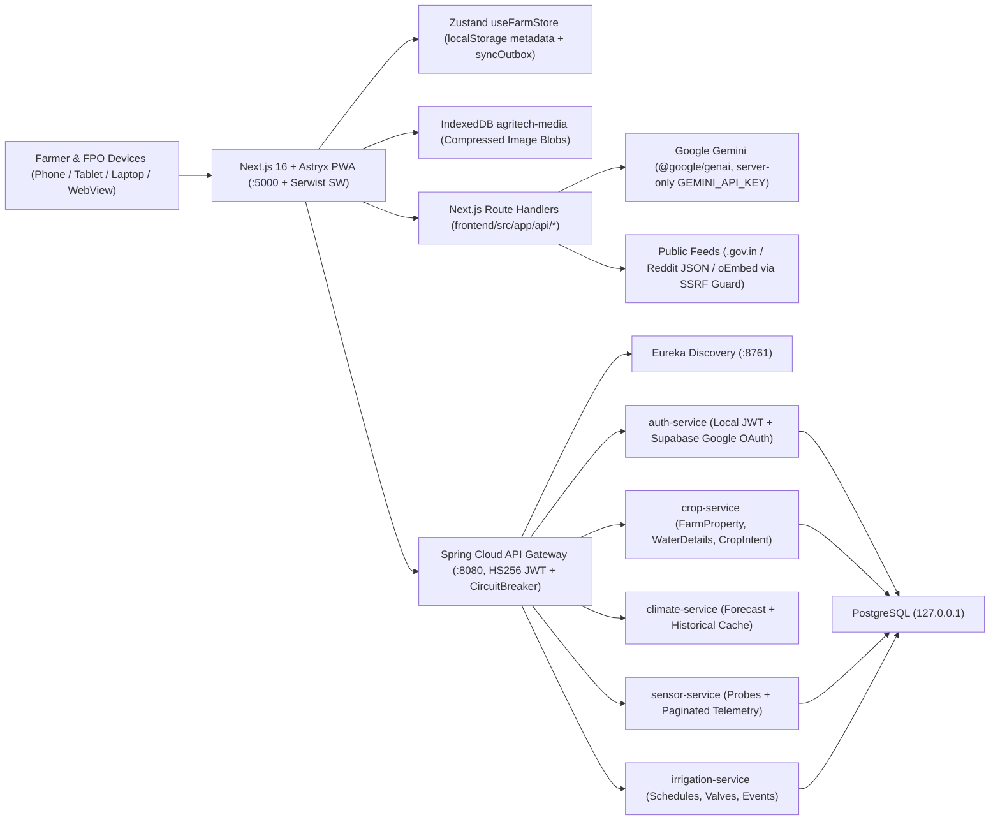
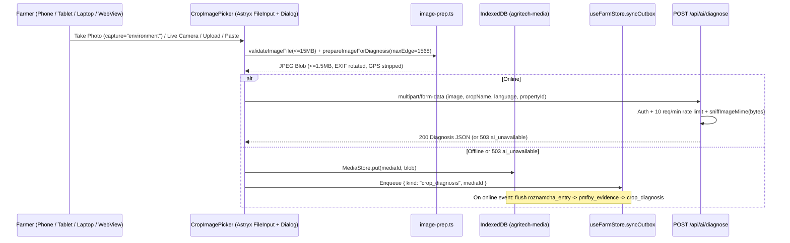

# ARCHITECTURE.md

System architecture for **AgriTech FieldShield & Daily Kisan Companion**, synthesized from the `786`-node / `1,762`-edge Graphify AST (`graphify-out/graph.json`), `@astryxdesign/core@0.7.17` component boundaries, verified Spring Boot `:8080` contracts, and all 10 Daily Kisan Companion features.

---

## 1. End-to-End System Topology

The platform pairs an installable, offline-first **Next.js 16 + Astryx Field Portal (`frontend/`, `:5000`)** with an existing **Spring Cloud Microservices Backend (`:8080`, Eureka `:8761`)**. All 10 Daily Kisan Companion enhancements execute inside `frontend/` and Next.js server route handlers (`/api/*`), leaving all Java services untouched.

---

## 2. Graphify Knowledge Graph Summary (`786` Nodes, `1,762` Edges)

AST extraction across `145` communities (`99%` `EXTRACTED`, `0%` `AMBIGUOUS`) defines the primary hubs in `frontend/`:

| Community / Hub | Primary File | Graph Role & Responsibilities |
|---|---|---|
| **Farm State & Outbox (`43` edges)** | `frontend/src/lib/property-store.ts` | `useFarmStore` (`farmerMode`, `farmLocation`, `properties`, `syncOutbox`), `usePropertyWizard`, `getActiveProperty()`, `safeStateStorage`, `clearSessionData()` |
| **Typed Gateway Client (`33` edges)** | `frontend/src/lib/api.ts` | `request()`, `tryRefreshJwt()`, `isOfflineToken()` guard, `authApi`, `propertyApi`, `sensorApi`, `valveApi`, `cropApi`, `climateApi`, `irrigationApi`, `telemetryApi` |
| **Astryx Workspace Shell (`32` edges)** | `frontend/src/components/AppLayout.tsx`, `AstryxProvider.tsx` | `agritechFieldTheme` (`Theme` + `LinkProvider`), desktop `SideNav`, mobile 5-tab `MobileNav`, parcel/location header, theme & 11-locale switchers |
| **Auth & Session Isolation (`30` edges)** | `frontend/src/lib/auth.ts`, `AuthProvider.tsx` | `useAuthStore`, Google OAuth via `supabase.ts` (`startGoogleSignIn` open-redirect guard), offline demo fallback, full logout purge |
| **Agronomic Engine** | `frontend/src/lib/fieldshield.ts` | Pure FAO-56 `computeWaterBudget()`, `evaluateValveInterlock()` (Rain-Hold `>=50%` or `>=10mm`, Soil-Saturation ceiling, Wind `>=20 km/h`), `buildVernacularShiftBriefing()` |
| **Spatial & 3D Visualization** | `FarmMap.tsx`, `FarmGoogleMap.tsx`, `FieldTerrain3D.tsx` | Leaflet + Esri/OpenTopoMap parcels, Google Maps acreage circles, `@react-three/fiber` 3D moisture beacon terrain with WebGL/`prefers-reduced-motion` fallback |
| **Internationalization** | `frontend/src/lib/i18n.tsx` | 11-locale dictionary (`en`, `hi`, `pa`, `mr`, `te`, `ta`, `kn`, `bn`, `gu`, `or`, `ml`) + `html[data-lang-script]` synchronization |

---

## 3. Architecture of Live Baseline & All 10 Scoped Companion Features

### 3.1 Live Baseline Modules (`LIVE`)
- **Auth & Onboarding (`/`, `/login`, `/signup`, `/properties/new`):** `LandingScrollStory`, `AuthSplitShell`, `GoogleSignInButton`, and 5-step parcel/soil/crop/sensor setup wizard.
- **Core Field Hub (`/dashboard`, `/properties`, `/sensors`, `/climate`, `/recommendations`, `/irrigation`, `/profile`):** Live `:8080` telemetry, 48 Indian crops (`crops.ts`), 7 soil types, valve schedules, CSV/JSON exports (`export-files.ts`), Astryx `<Skeleton>`, `<Banner>`, `<AlertDialog>`, and `<Breadcrumbs>`.

### 3.2 Scoped Daily Kisan Companion Modules (`SCOPED v3` - Master Plan Tasks `1-8`)

*(Note: Master Plan v3 splits Universal Media Capture out as **Task 5** so both Schemes **Task 6** and Crop Doctor/Voice/FPO **Task 7** share one tested camera/IndexedDB pipeline before Mobile Nav/E2E **Task 8**.)*

| # | Feature | Route & Plan Task | Astryx UI Surface | Pure Lib & API Route | Offline & Persistence Strategy |
|---|---|---|---|---|---|
| **1** | **Simple Farmer Mode + Location Cascade** | `/dashboard`, Header (`Task 1 & 2`) | `SegmentedControl` (`simple \| full`), 3x `Selector` (`State -> District -> Mandal`), `Grid` + `>=52px` `ClickableCard` tiles | `indian-locations.ts`, `property-store.ts` | Persisted in `useFarmStore`; syncs `/mandi`, `/updates`, `/schemes` automatically |
| **2** | **Deterministic 6 AM Action Card** | `/dashboard` (`Task 2`) | `Card`/`BezelCard` focal anchor, `StatusDot` Spray-Safe Clock (`SAFE/CAUTION/HOLD`), `Button` (`Listen`, `WhatsApp`) | `fieldshield.ts`, `daily-briefing.ts`, `/api/ai/tts` | 100% deterministic offline Water/Spray/Market verdict; `gemini-3.8-flash-lite-tts` WAV or `speechSynthesis` fallback |
| **3** | **Kisan Roznamcha** | `/dashboard` (`Task 2`) | `Drawer` (`>=640px`) / `BottomSheet` (`<640px`), `List` + `Item` + `Timestamp`, `@media print` sheet | `roznamcha.ts` | Auto-signed valve/moisture/weather entries queued in `syncOutbox` (`roznamcha_entry`) |
| **4** | **"Kyun?" Dialect Explanations** | Verdict cards (`Task 2`) | `Collapsible` / `ToggleButton` + `Section` + `.type-lead` `Text` | `daily-briefing.ts` (`evaluateValveInterlock().reasons`) | 2-sentence Indic explanation citing exact moisture %, rain mm/prob, and wind km/h |
| **5** | **State Agri-Pulse & Custom Link Truth Shield + Image Report** | `/updates` (`Task 3`) | `SegmentedControl`, `InputGroup`+`TextInput`, `ProgressBar` (`0-100%`), `Collapsible` rubric, `Citation`, `List`/`Item` rows | `url-safety.ts`, `truth-score.ts`, `truth-report-image.ts`, `/api/state-pulse/{feed,verify}` | Stale-while-revalidate feed + SSRF pre-check + offline `1080x1080` Canvas PNG report for WhatsApp groups |
| **6** | **Mandi & MSP Board + Personal Break-Even Bar** | `/mandi` (`Task 4`) | Controlled `NumberInput` cost bar + `ProgressBar`, edge-to-edge `Table` (`en-IN` `₹/q`, `StatusDot`) | `mandi-data.ts`, `GET /api/mandi` | Cached APMC/e-NAM rates + instant client break-even margin after transport |
| **7** | **Govt Schemes, AgriStack & 72-Hr PMFBY Locker** | `/schemes` (`Task 5 & 6`) | `TabList`/`Tab`, PMKSY `45%/55%` `NumberInput`, `CheckboxList` (11-digit Farmer ID), live 72-hr `Timer` | `schemes-data.ts`, `media-queue.ts`, `GET /api/schemes` | Checklists in `localStorage`; GPS + compressed crop-loss photos in IndexedDB (`pmfby_evidence`) |
| **8** | **Crop Photo Doctor** | Modal / Simple Mode (`Task 5 & 7`) | `Dialog`, `CropImagePicker` (`FileInput` `capture="environment"`, `LiveCameraModal`, gallery, drop/paste), `Thumbnail`, `Banner` | `media-capabilities.ts`, `image-prep.ts`, `image-sniff.ts`, `POST /api/ai/diagnose` | `gemini-3.8-flash` structured JSON (`isHealthy`, `problems[]`, per-acre medicines) or IndexedDB queue (`crop_diagnosis`) |
| **9** | **Vernacular Voice Companion + FPO 1-to-50 Broadcast** | Sheet + `/dashboard` (`Task 7`) | `BottomSheet`/`Drawer` + editable `TextArea` transcript, FPO `Table`/`List` + `Button` broadcast | `/api/ai/transcribe` (`gemini-3.5-transcribe`), `/api/ai/tts`, `FpoBroadcastPanel` | Web Speech fallback offline; aggregates 50 member parcels into one WhatsApp morning crew card |
| **10** | **Installable Offline-First PWA & Mobile 5-Tab Thumb Bar** | App Shell (`Task 1 & 8`) | `Banner` (`OnlineStatusBanner`), `PWAInstallButton`, `MobileNav` (`Today`, `Mandi`, `Updates`, `Schemes`, `Camera/Voice`) | `manifest.ts`, `sw.ts` (`@serwist/next`), `AppLayout.tsx`, `i18n.tsx` | Precached shell + `<=15%` sticky chrome + Playwright verification at `390x844` and `1280x800` |

---

## 4. Universal Media Capture & IndexedDB Queue Sequence

Binary photos never enter Zustand/`localStorage` (`safeStateStorage` ~5 MB cap). Compressed JPEGs (`<= 1568 px`, `<= 1.5 MB`, EXIF/GPS stripped) live in IndexedDB (`agritech-media`) behind an injectable `MediaStore` interface, referenced by `mediaId` in `syncOutbox`.

---

## 5. Truth Shield Verification Pipeline (`SCOPED v3`)

`POST /api/state-pulse/verify` evaluates pasted WhatsApp forwards, Instagram reels, Reddit threads, X posts, and YouTube links without allowing ungrounded AI percentages:

1. **SSRF & Scam Pre-Check (`url-safety.ts`):** Rejects non-HTTP(S) schemes, `localhost`, `127.0.0.0/8`, `10.0.0.0/8`, `172.16.0.0/12`, `192.168.0.0/16`, `169.254.0.0/16`, and `::1`. Flags `.apk` downloads, URL shorteners, and lookalike phishing domains immediately.
2. **Claim Extraction:** Reads public metadata/captions (Reddit JSON, OpenGraph, oEmbed); falls back cleanly to user-pasted text or voice transcript when social login walls block metadata.
3. **Deterministic 4-Factor Rubric (`truth-score.ts`):**
   - `Official .gov.in / .nic.in Corroboration`: `0-50` pts
   - `Independent Cross-Source Match (KVK / Regional Media)`: `0-20` pts
   - `Seasonal & Date Recency`: `0-15` pts (`0` pts + recycled warning on old clips)
   - `Ground & Scam Safety`: `0-15` pts (`0` pts + `scamWarning: true` on phishing/fee traps)
4. **Shareable Report (`truth-report-image.ts`):** Renders a `1080x1080` client-side HTML5 Canvas PNG stamping the Truth %, Verdict (`VERIFIED_OFFICIAL` / `PARTIALLY_VERIFIED` / `UNVERIFIED_RUMOUR`), 2-sentence dialect summary, and source breakdown for `navigator.share({ files })` or PNG download.

---

## 6. Security & Trust Boundaries

| Boundary | Enforcement Mechanism |
|---|---|
| **Spring Cloud Gateway (`:8080`)** | `JwtAuthFilter` path-traversal rejection (`400`), `ADMIN`-scoped `ActuatorAuthWebFilter`, sanitized `X-Device-Id` rate limiting, `CircuitBreaker` failover. |
| **CSP & Permissions-Policy (`next.config.ts`)** | Update `next.config.ts` from `camera=(), microphone=()` to `camera=(self), microphone=(self), geolocation=(self)` and add `media-src 'self' blob:` while keeping `frame-ancestors 'none'` and `object-src 'none'`. |
| **SSRF & Scam Pre-Check (`url-safety.ts`)** | Blocks non-HTTP(S) schemes, `localhost`, loopback, link-local, and RFC1918 private IPs before fetching custom WhatsApp/Instagram/Reddit/X/YouTube URLs; flags `.apk` and phishing domains (`0` Ground Safety pts + `scamWarning: true`). |
| **Auditable Truth Score (`truth-score.ts`)** | Computed strictly from 4 deterministic weights (`Official .gov.in 0-50` + `Cross-Source 0-20` + `Recency 0-15` + `Ground/Scam Safety 0-15`), never guessed directly by an LLM. |
| **Server-Only AI & Upload Guardrails** | `process.env.GEMINI_API_KEY` stays server-only via `@google/genai >= 2.29.1` (`gemini-3.8-flash`, `gemini-3.5-transcribe`, `gemini-3.8-flash-lite-tts`); `/api/ai/diagnose` enforces `<= 4 MB`, `sniffImageMime` magic bytes, `25s` timeout, honest `503 ai_unavailable` fallback, and `<60%` confidence referral to KVK + `1800-180-1551`. |
| **Logout & Tenant Purge** | `clearSessionData()` wipes `properties`, `syncOutbox`, Roznamcha logs, PMFBY metadata, Truth Shield history, and IndexedDB `agritech-media`. |

---

## 7. Related Specifications & Reports

- Detailed v3 Technical Spec: [docs/superpowers/specs/2026-11-28-kisan-companion-architecture.md](./docs/superpowers/specs/2026-11-28-kisan-companion-architecture.md)
- Master v3 Implementation Plan: [docs/superpowers/plans/2026-11-28-agritech-daily-kisan-companion.md](./docs/superpowers/plans/2026-11-28-agritech-daily-kisan-companion.md)
- Backend API Guide: [API-USAGE-GUIDE.md](./API-USAGE-GUIDE.md)
- Full-Stack Rubric & Security Verification: [docs/RUBRIC-VERIFICATION-REPORT.md](./docs/RUBRIC-VERIFICATION-REPORT.md) and [SECURITY-AUDIT-2026-10-28.md](./SECURITY-AUDIT-2026-10-28.md)
