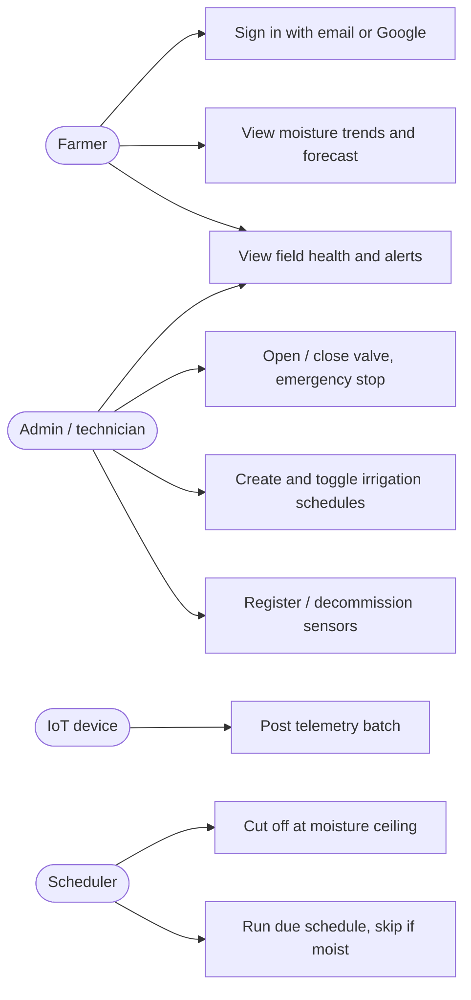

# AgriTech Sensing Solutions: Product Requirements Document

| | |
|---|---|
| Version | 1.2 (Current codebase) |
| Status | Implemented and verified. Every requirement below maps to code and tests (section 14) |
| Architecture | Spring Boot 3.3.4 / Spring Cloud 2023.0.3 microservices (9 Maven modules: 6 domain services, `api-gateway`, `eureka-server`, `common`), Eureka discovery, Spring Cloud Gateway |

Section numbers are stable: source code cites them (`PRD 7.1`, `FR-4`, ...), so a reader can move
from any comment in the code straight to the requirement it satisfies.

---

## 1. Problem statement

Agriculture accounts for about **70 % of global freshwater withdrawals** (FAO AQUASTAT). In India,
most farms still irrigate by **calendar and habit** ("water every third morning"), using flood or
furrow methods whose field application efficiency is commonly put at **35–40 %**. That causes three
compounding losses:

1. **Water and energy waste.** Fields get watered when the soil is already moist. The pump runs
   and the water drains below the root zone.
2. **Yield loss from late action.** Stress builds between the farmer's field walks. By the time
   wilting is visible, the plant has already lost growth.
3. **No evidence trail.** Decisions aren't recorded, so nobody can say which fields are
   over-watered or what a schedule change actually saved.

**The problem in one sentence:** irrigation decisions are made without current soil data, so water
is applied when it is not needed and withheld when it is.

**Product hypothesis:** if soil moisture, temperature and pH are measured continuously, scored
against each crop's optimal band, and fed back into valve control, then a farm can:

- skip unnecessary irrigation runs,
- detect crop stress hours earlier, and
- let one operator supervise many fields from one screen.

## 2. Stakeholders and personas

| Persona | Role in system | Primary need | Pain today |
|---|---|---|---|
| **Farm operator / owner** (Ravi, 42, 6 ha, paddy + chilli) | `FARMER` (read) | "Tell me which field needs attention *now*, in plain words." | Walks every field daily; learns of stress too late |
| **Field technician / agronomist** | `ADMIN` (write) | Register sensors, set schedules, override valves safely | Manual valve operation; no remote stop |
| **IoT device** (soil probe) | Device credential, ingest only | Post readings cheaply and have bad readings rejected, not silently stored | Out-of-range readings pollute analysis |
| **Platform operator** (DevOps) | none (infrastructure) | Add capacity, find failures, keep one service's outage contained | Monoliths fail as a whole |
| **Evaluator / examiner** | none | Trace every claim to code and a test | Specs that can't be verified |

These roles have deliberately different permissions: read-only farmers and write-capable admins
(FR-2). That difference is what makes the security model more than decoration.

## 3. Design-thinking discovery (how the requirements were found)

The requirements came out of a Design Thinking and Innovation (DTI) cycle, not from a technology
wish-list.

| DTI stage | What we did | What it produced |
|---|---|---|
| **Empathize** | Studied the daily routine of small and medium farms. Mapped the "field walk → guess → water" loop. Designed a farmer survey to test these assumptions (instrument in `docs/survey/`) | The three losses in section 1 |
| **Define** | Wrote point-of-view statements. **POV-1:** *A farmer managing several fields needs to know which field is under stress without walking to it, because stress seen by eye is stress already paid for.* **POV-2:** *A technician needs to stop all water instantly and remotely, because a burst line cannot wait for someone to walk out to it.* | FR-5, FR-6, FR-8 |
| **Ideate** | "How might we" prompts: *HMW water only when the soil asks for it? HMW turn numbers into advice? HMW keep one broken sensor from breaking the farm?* | Closed-loop `skipIfMoist`, plain-language recommendations, independent services with circuit breakers |
| **Prototype** | Built six Spring Boot domain services behind `api-gateway` and `eureka-server` (9 Maven modules including `common`), a device simulator (13 devices, 4 fields, 48 h backfill), and dashboards (`frontend/` React+Vite and `web/` Next.js 16) | This repository |
| **Test** | 95 unit and integration tests across 17 test classes (10 Maven reactor modules), a 33-check end-to-end smoke test, a 14-check load-balancing/failover test, an 18-check CRUD/LB demo, a 37-check security probe suite, and an 84-request (124-assertion) Postman collection. Service-outage failover was tested by killing an instance live | Section 9 |

## 4. Goals, success metrics and non-goals

| Goal | Metric | Target | How it is measured |
|---|---|---|---|
| Stop needless watering | Share of scheduled runs skipped because soil was already moist | Reported per run (`IrrigationScheduler`, `skipIfMoist`) | Irrigation events log `/api/irrigation/events` |
| Detect stress early | Time from threshold breach to alert | ≤ 5 min (analysis cadence, PRD 5.1) | `CropAnalysisService` schedule |
| Forecast need | Irrigation forecast horizon | 48 h | `HealthScore` / `hoursToIrrigation` |
| Supervise at scale | Fields visible to one operator | All farm fields on one dashboard | Dashboard |
| Stay available | Outage of one service must not take down the others | Other routes keep answering 200 | Verified live: crop-service killed, sensors still 200 |

**Non-goals for this release:** see section 15 (scope boundaries) and section 16 (Phase 2+).

## 5. Functional requirements

### 5.1 Data freshness
Crop health metrics are recomputed **every 5 minutes** from the latest field telemetry.
Operators can also trigger a recomputation on demand (FR-5).

### 5.2 Functional requirement list

| ID | Requirement | Acceptance criterion |
|---|---|---|
| **FR-1** | **Authentication and session lifecycle.** Email and password login issues a signed JWT access token (HS256, **15 min**), carrying subject, role, farm and a unique `jti`, plus a DB-backed 30-day refresh token (`auth_service.stored_tokens`). Refresh **rotates** the refresh token atomically (single-use). Self-registration pins `FARMER` with a unique `FARM-xxxxxxxx` tenant ID; `PUT/DELETE /api/auth/me` support password change and account deletion; logout **revokes** the access token at the gateway. | Login 200 with token (`expiresIn: 900`); wrong password 401; reused refresh token 401; logged-out token 401; register with `role: ADMIN` still returns `FARMER` |
| **FR-2** | **Role-based authorization and multi-tenancy.** Only `ADMIN` (or peer `SERVICE` callers) may register, update or deregister devices; only `ADMIN` may create or modify schedules, manage valves, or stop all farms. `FARMER` is read-only on infrastructure, may create/edit/delete their own farm properties, and can trigger emergency stop on their own farm. All resource reads/writes enforce tenant `farmId` ownership via `CallerContext` (cross-tenant IDs return 404 to block enumeration). | Farmer `POST /api/sensors/register` returns 403, even with a spoofed `X-User-Role: ADMIN` header; cross-tenant `/api/crops/{id}` and `/api/sensors/{id}` return 404 |
| **FR-3** | **Sensor device management.** Register, update, decommission and list devices with pagination and filters (`page`, `size`, `q`, `health`, `fieldId`). Both `ADMIN` and peer `SERVICE` callers (`crop-service`) can provision, update, and deregister devices. Health is derived as ONLINE, OFFLINE (no reading in 15 min) or LOW_BATTERY (< 20 %). | CRUD calls. Seeded dark device (`SENSOR-FARM01-013`) shows OFFLINE |
| **FR-4** | **Telemetry ingestion and history.** Bulk ingest where each reading is validated **independently**: moisture 0–100 %, soil temperature −50 to 80 °C, pH 0–14, battery 0–100 %, plus optional environmental fields (air temperature, humidity, light, NPK, rainfall, water level), with per-reading tenant ownership checks (`canIngest`). History windows are selectable (`1h`, `24h`, `7d`, `30d`, `90d`, or `from`/`to`). | 812 % moisture is rejected with `accepted=0`, while valid readings in the same batch are stored; cross-tenant ingest is rejected per reading |
| **FR-5** | **Crop field management and health scoring.** CRUD on `/api/crops` plus a 0–100 score per field against the crop's optimal moisture, temperature and pH band, weighted 50/30/20. Includes the health trend and environment series. | `HealthScoreTest`. Live score within 0–100; `crud-demo.sh` exercises POST/GET/PUT/DELETE |
| **FR-6** | **Insight and alerts.** Status OPTIMAL, WARNING or CRITICAL, with plain-language recommendations and a time-to-irrigation forecast within 48 h. | `/api/crops/alerts`. Recommendations in the analyze response |
| **FR-7** | **Irrigation scheduling.** DAILY or WEEKLY schedules per valve, with create, update, activate/deactivate (PATCH) and delete. `skipIfMoist` defaults on. | `IrrigationSchedulerTest`. Smoke test creates and deletes a schedule |
| **FR-8** | **Valve control and safety.** Full CRUD on `/api/valves`, manual open for 1–240 minutes, and close. Opening is **refused (409)** when the field is already saturated. A running zone shuts off at the moisture ceiling. Emergency stop closes all valves (`ADMIN`) or the caller's own farm's valves (`FARMER`). | Smoke test: open 200/409, status, emergency stop |
| **FR-9** | **Service collaboration through discovery.** `crop-service` calls `sensor-service` (`SensorClient`), `climate-service` (`ClimateServiceClient`), and `recommendation-service` (`RecommendationServiceClient`); `irrigation-service` reads crop health and notifies `sensor-service` (`FarmClient`). All calls address **Eureka service IDs** via `@LoadBalanced` clients, never hosts or ports. | Smoke test and `lb-test.sh`: crop metrics, climate/recommendation orchestration, and valve checks route through Eureka |
| **FR-10** | **Federated sign-in.** Google sign-in (validated through Supabase `/auth/v1/user` introspection) provisions a `FARMER` account on `FARM-001` on first use. | `SupabaseVerifierTest` (7 tests) |
| **FR-11** | **Farm property onboarding, simulated kits, and daily reports.** Authenticated accounts manage properties via `/api/farm/me` and `/api/farm/properties/**`, select from 48 Indian crops (`CropCatalog`), run physical crop-tuned `FarmSimulation`, and inspect IST daily reports (`/api/farm/me/reports/**`). | `PropertyRegistrationTest` (4), `ReportBuilderTest` (12), `FarmSimulationTest` (5) |
| **FR-12** | **Historical climate analytics and crop recommendations.** `climate-service` (`/api/climate/history`) retrieves Open-Meteo historical data and computes ET0, water balance, growing degree days, and stress risks. `recommendation-service` (`/api/recommendations/score`) ranks the 48-crop catalog (`recommendation_service.crops`) by temperature, water, soil, season, and trend risk weights. | `ClimateStatisticsTest` (2), `CropRecommendationServiceTest` (3), smoke test |

### 5.3 Error contract
Every error from every service and from the gateway uses one JSON envelope:
`{"error": "<code>", "message": "<human text>", "timestamp": "..."}` (see 7.3).

### 5.4 Audit
Every authentication attempt (success and failure), every logout, and every rejected token is
written to the `AUDIT` logger. Every request through the gateway is written to the `ACCESS` logger
with its correlation id, status and latency.

## 6. Non-functional requirements

| ID | Quality | Target | Measured result |
|---|---|---|---|
| **NFR-1** | Performance: end-to-end latency through the gateway (JWT validation + rate limit + routing + service) | p95 < 100 ms for reads on a developer laptop | **p50 18–28 ms, p95 38–47 ms**, n = 450 (`/api/sensors/summary`, `/api/crops`, `/api/valves`) |
| **NFR-2** | Capacity protection | 100 req/min public (per IP), 1000 authenticated (per user), 100 per device | `RateLimitFilter`, `X-RateLimit-*` headers |
| **NFR-3** | Availability and fault isolation | A failed service yields a fast 503 with `Retry-After`. Other routes are unaffected | Circuit breaker per route (7.5). Verified by killing crop-service |
| **NFR-4** | Scalability | Any service scales horizontally by starting another instance. No config change needed | `lb://` + Eureka round-robin (8.2) |
| **NFR-5** | Security | No endpoint reachable without a valid token except the listed public paths. Services reject calls without a valid gateway HMAC signature | Sections 7.4 and 10. 54 auth/security/tenant unit tests across 7 classes + 37 checks in `scripts/security-probes.py` |
| **NFR-6** | Accessibility | WCAG 2.1 AA contrast (≥ 4.5:1) in both themes | README design-system notes |
| **NFR-7** | Maintainability | One responsibility per service, shared code only in `common`, every requirement traceable | Section 14 |
| **NFR-8** | Payload safety | Request bodies capped at 1 MB | Smoke test: 1.1 MB body returns 413 |

## 7. API gateway specification

### 7.1 Routing: single entry point
| Route ID | Path | Service |
|---|---|---|
| `auth-service` | `/api/auth/**` | `lb://auth-service` |
| `sensor-service` | `/api/sensors/**`, `/api/telemetry/**` | `lb://sensor-service` |
| `crop-service` | `/api/crops/**`, `/api/farm/**` | `lb://crop-service` |
| `climate-service` | `/api/climate/**` | `lb://climate-service` |
| `recommendation-service` | `/api/recommendations/**` | `lb://recommendation-service` |
| `irrigation-service` | `/api/irrigation/**`, `/api/valves/**` | `lb://irrigation-service` |
| `*-service-docs` (6 routes) | `/<service>/v3/api-docs` (`SetPath=/v3/api-docs`) | `lb://<service>` |

Routes target `lb://<service-id>` (`discovery.locator.enabled: false`, no `StripPrefix`). No host or port appears anywhere in the gateway route definitions. Aggregated API documentation is served at `/swagger-ui.html`.

### 7.2 Rate limiting
Three tiers (NFR-2). `RateLimitFilter` charges every applicable bucket (IP, authenticated user, caller-scoped `X-Device-Id`) and enforces the strictest quota; `X-Forwarded-For` is ignored unless `agritech.rate-limit.trust-forwarded-for=true`. Every response carries `X-RateLimit-Limit` and `X-RateLimit-Remaining`. The 429 response uses the 7.3 envelope.

### 7.3 Error envelope
See 5.3. Gateway filter rejections (`GatewayResponses`: 401, 429) and circuit-breaker fallbacks (`FallbackController`: 503) use the `{"error", "message", "timestamp"}` shape alongside `common/ApiExceptionHandler`. Unmatched WebFlux routes (`NotFoundHandler`, `GlobalErrorWebExceptionHandler`) return structured JSON (`{timestamp, status, error, path, message}`).

### 7.4 Edge security (ordered global filters)
1. **RequestIdFilter** (order −200). Assigns or propagates `X-Request-Id`, marks responses
   `Cache-Control: no-store`, and writes the access log.
2. **JwtAuthFilter** (order −100). Verifies signature, expiry and revocation. API/actuator paths in `PUBLIC_PATHS` (`/api/auth/login`, `/api/auth/register`, `/api/auth/refresh`, `/api/auth/google`, `/actuator/health`, `/fallback`, `/swagger-ui.html`, and the 6 `/<service>/v3/api-docs` paths) are **exact matches** (so `/api/auth/loginX` returns 401), while Swagger/fallback asset paths (`/fallback/**`, `/swagger-ui/**`, `/webjars/**`, `v3/api-docs`) are also permitted. **Always strips** client-supplied identity and signature headers (`X-User-*`, `X-Gateway-*`), then sets verified ones and **HMAC-signs** them (`X-Gateway-Signature`, `X-Gateway-Timestamp`). Both signing secrets are validated at startup with no committed defaults (`GatewaySecrets`, `Secrets`).
3. **RateLimitFilter** (order −50).
4. Default route filters: **SecureHeaders** (CSP, HSTS, X-Frame-Options DENY, nosniff,
   Referrer-Policy, …) and **RequestSize** (1 MB).

### 7.5 Resilience
Each of the six API routes places a **Resilience4j circuit breaker** outside a **Retry** filter (`2` retries on `GET` requests for `java.io.IOException` and `reactor.netty.http.client.PrematureCloseException`, so stale pooled keep-alive sockets after an instance dies retry safely without re-sending mutations; verified by `RouteRetryConfigTest`):

- It **opens** when 50 % of the last 10 calls fail (minimum 5 calls).
- It stays open for 10 s, then **probes** with 2 half-open calls.

Its fallback (`/fallback/<service>`) returns 503 with `Retry-After: 10`. Connection timeout is 2 s
and response timeout is 10 s. Breaker state is visible at `/actuator/circuitbreakers`.

## 8. Service discovery

### 8.1 Health checks
Instances renew their lease with Eureka every **30 s** and are evicted after **90 s** without renewal.

### 8.2 Load balancing
Gateway routes and inter-service `RestTemplate`s are `@LoadBalanced`. Calls are round-robined
across healthy instances of a service ID, so adding capacity means starting another process.

## 9. Verification plan

| Level | Artifact | Count |
|---|---|---|
| 9.1 Unit & integration | 17 test classes across 8 tested modules (10 Maven reactor modules incl. parent & `eureka-server` with 0): `common` (`ApiExceptionHandlerTest` 4, `CallerContextTest` 8, `InternalAuthTest` 10), `api-gateway` (`JwtAuthFilterTest` 8, `RouteRetryConfigTest` 1), `auth-service` (`AuthControllerWebTest` 7, `AuthServicePersistenceTest` 6, `SupabaseVerifierTest` 7), `sensor-service` (`DeviceSimulatorTest` 1, `FarmSimulationTest` 5, `SensorControllerTenantTest` 8), `crop-service` (`HealthScoreTest` 5, `PropertyRegistrationTest` 4, `ReportBuilderTest` 12), `climate-service` (`ClimateStatisticsTest` 2), `recommendation-service` (`CropRecommendationServiceTest` 3), `irrigation-service` (`IrrigationSchedulerTest` 4) | 95 tests (17 classes) |
| 9.2 API | `AgriTech_Fast_Test.postman_collection.json` (auto-saves the token; covers auth, sensors, telemetry, crops, valves, schedules, `/api/farm/**`, `/api/climate/**`, `/api/recommendations/**`, RBAC, Eureka, OpenAPI/Swagger, gateway) | 84 requests / 14 folders (86 executed incl. 2 auto-login prerequests, 124 assertions) |
| 9.3 End-to-end | `scripts/smoke-test.sh`. **Scenario 1:** ingestion → health → irrigation, climate, recommendations. **Scenario 2:** authentication, routing, authorization. **Scenario 3:** discovery (7 services), token lifecycle, gateway hardening (6 circuit breakers) | 33 checks |
| 9.4 Load balancing & CRUD | `scripts/lb-test.sh` (14 checks: Eureka replicas, `lb://` splits, shared DB, inter-service LB, live `:18082` kill failover 20/20 + 6/6) and `scripts/crud-demo.sh` (18 checks: JWT, crop CRUD, 40-read round-robin, shared DB) | 14 + 18 checks |
| 9.5 Security probes | `scripts/security-probes.py` across 5 groups (`auth`, `idor`, `harden`, `crud`, `lb`; `H05` unauthenticated `:8761` accepted for local demo) | 37 checks |
| 9.6 Fault injection | Kill a service mid-run, then check for a fast 503 fallback while the other routes stay 200 | Manual + `lb-test.sh` |
| 9.7 Frontend UI | In-repo `frontend/tests/sensorCapabilities.test.js` + `scripts/e2e/farm-flow.js` + `scripts/check-i18n.mjs`; companion Next.js 16 frontend (`c:\Users\anjan\Downloads\SOA-Hackthon\frontend`, `:5000`) | 69 Vitest + 51 Playwright (companion UI) |

## 10. Security model and threat analysis

| Threat | Control | Evidence |
|---|---|---|
| Password disclosure & account enumeration | BCrypt hashes + per-process `dummyHash` timing equalization on login and password change | `AuthController`, `AuthService` (`A08` probe) |
| Self-registration escalation | `POST /api/auth/register` ignores caller `role`, always pins `FARMER` with unique `FARM-xxxxxxxx` | `AuthService.register`, `AuthControllerWebTest`, `A02` probe |
| Cross-tenant IDOR & enumeration | `CallerContext.requireAccess` (returns 404), `scopeListFilter`, `TelemetryController.canIngest` | `CallerContextTest` (8), `SensorControllerTenantTest` (8), `B01`–`B12` probes |
| Forged or tampered token | HS256 signature verified at the gateway. `alg:none` is refused | `JwtAuthFilterTest` (8), `A03`/`A04` probes |
| Expired or stolen token | 15-minute access TTL (`access-ttl-minutes: 15`). Atomic DB-backed refresh rotation (`findByIdForUpdate`). `jti` revocation on logout | `AuthServicePersistenceTest`, smoke test (refresh replay → 401, logout → 401) |
| Role escalation via headers | Gateway strips `X-User-*` and `X-Gateway-*` on **every** request, including public ones | `JwtAuthFilterTest.clientSuppliedIdentityHeadersAreReplaced` |
| Bypassing the gateway (calling :8082 directly) | Services accept `/api/**` only with a constant-time HMAC gateway signature ≤ 60 s old. Peer services sign calls as `SERVICE` | `InternalAuthTest` (10 cases). Smoke test & `H01`/`H02`: direct call → 401 |
| Prefix-matching public paths | Exact-match `PUBLIC_PATHS` for auth/API endpoints (asset prefixes scoped to `/swagger-ui`, `/webjars`, `/fallback/`, `v3/api-docs`) | `JwtAuthFilterTest.publicPathsAreExactMatches`, smoke test (`/api/auth/loginX` → 401) |
| Flooding and oversized payloads | Three-tier rate limit charging every applicable bucket (strictest wins, `trust-forwarded-for: false`). 1 MB body cap | `RateLimitFilter`, smoke test (413), `H06`/`H07` probes |
| Clickjacking, MIME sniffing, downgrade | SecureHeaders: X-Frame-Options, nosniff, HSTS, CSP | Smoke test |
| Sensitive data cached by browsers or proxies | `Cache-Control: no-store` | `RequestIdFilter`, smoke test |
| Secrets in source | Built-in defaults removed; `Secrets` and `GatewaySecrets` reject missing, `< 32`-char, or published-default keys at startup. `stack.ps1` generates local keys into gitignored `.env` | `Secrets.java`, `GatewaySecrets.java`, `.env.example` |

## 11. Observability

### 11.1 Metrics
The following are exposed:

- `/actuator/health` and `/actuator/info` on every service,
- `/actuator/metrics` on the 5 domain/analytics services (`sensor`, `crop`, `climate`, `recommendation`, `irrigation`),
- `/actuator/circuitbreakers` on the gateway (exposing all 6 route breakers; `/actuator/gateway/routes` remains disabled by default in Spring Cloud Gateway 4.x),
- `/api/telemetry/stats` for ingestion volume.

The `X-Request-Id` correlation id appears in the gateway `ACCESS` log and is forwarded to every
service.

## 12. Constraints and assumptions

- Runs on one developer machine, Java 21+, with no Docker required. `scripts/stack.ps1` builds all 9 child Maven modules (`pom.xml`) and starts all 8 processes in dependency order (`eureka-server` `:8761`, `auth-service` `:8081`, `sensor-service` `:8082`, `crop-service` `:8083`, `climate-service` `:8086`, `recommendation-service` `:8087`, `irrigation-service` `:8084`, `api-gateway` `:8080`), or 11 processes with `-Replicas` (`:18082`–`:18084`).
- Each stateful service owns a dedicated PostgreSQL schema (`auth_service`, `sensor_service`, `crop_service`, `recommendation_service`, `irrigation_service`; `climate-service` is stateless). When `DB_URL` is unset, local fallback uses one persistent H2 file per service under `.run/data/` (`AUTO_SERVER=TRUE;DATABASE_TO_LOWER=TRUE`). Flyway manages schema migrations on `auth_service` (`V1`), `crop_service` (`V1`–`V4`), and `recommendation_service` (`V1`). No service reads another's database.
- Devices can reach the gateway over HTTP(S) and post JSON. The bundled simulator stands in for
  field hardware.
- Soil optimal bands per crop are agronomic defaults across 48 Indian crops (`CropCatalog`) and are configurable per crop.

## 13. Actors and use cases

## 14. Traceability matrix

| Req | Implemented in | Verified by |
|---|---|---|
| FR-1 | `auth-service/JwtService`, `AuthService`, `TokenStore`, `AuthController` (`/login`, `/refresh`, `/logout`, `/me`), `api-gateway/JwtAuthFilter`, `RevocationCache` | `JwtAuthFilterTest` (8), `AuthControllerWebTest` (7), `AuthServicePersistenceTest` (6), smoke test (login, refresh rotation, logout) |
| FR-2 | `common/CallerContext` (`requireAdmin`, `requireAccess`, `scopeListFilter`), `common/InternalAuth` | `CallerContextTest` (8), `InternalAuthTest` (10), `SensorControllerTenantTest` (8), smoke test (farmer 403, escalation 403) |
| FR-3 | `sensor-service/SensorController`, `SensorDevice.health()` | `SensorControllerTenantTest` (8), smoke test (register, delete), Postman |
| FR-4 | `sensor-service/TelemetryController.ingest/validate/history` | Smoke test (valid accepted, 812 % rejected), `B10` probe, Postman |
| FR-5 | `crop-service/HealthScore`, `CropAnalysisService`, `CropController` | `HealthScoreTest` (5), `crud-demo.sh` (18), smoke test (score 0–100) |
| FR-6 | `HealthScore` forecast, `CropController.alerts` | `HealthScoreTest` (5), Postman |
| FR-7 | `irrigation-service/IrrigationController`, `IrrigationScheduler` | `IrrigationSchedulerTest` (4), smoke test (create, delete) |
| FR-8 | `ValveController`, `ValveService` | Smoke test (open, status, emergency stop), Postman |
| FR-9 | `crop-service/SensorClient`, `ClimateServiceClient`, `RecommendationServiceClient`, `irrigation-service/FarmClient`, `@LoadBalanced` | Smoke test, `lb-test.sh` (14 checks), `crud-demo.sh` |
| FR-10 | `SupabaseVerifier`, `AuthController.google` | `SupabaseVerifierTest` (7) |
| FR-11 | `crop-service/FarmController`, `FarmService`, `ReportBuilder`, `sensor-service/FarmSimulation` | `PropertyRegistrationTest` (4), `ReportBuilderTest` (12), `FarmSimulationTest` (5), Postman |
| FR-12 | `climate-service/ClimateController`, `ClimateStatistics`, `recommendation-service/RecommendationController`, `CropRecommendationService` | `ClimateStatisticsTest` (2), `CropRecommendationServiceTest` (3), smoke test (`/api/climate/history`, `/api/recommendations/score`), Postman |
| NFR-1 | Gateway pipeline | Latency run (section 6) |
| NFR-2 | `RateLimitFilter` | Smoke test (headers), `H06`/`H07` probes |
| NFR-3 | Gateway `CircuitBreaker` + `Retry` + `FallbackController` | `RouteRetryConfigTest` (1), fault-injection run (`lb-test.sh` 20/20 + 6/6 failover), smoke test (6 breakers) |
| NFR-4 | Eureka + `lb://` | Smoke test (7 services registered), `lb-test.sh` (14 checks) |
| NFR-5 | Sections 7.4 and 10 | 54 auth/security/tenant unit tests across 7 classes + 37 checks in `scripts/security-probes.py` + smoke checks |
| NFR-8 | `RequestSize` default filter | Smoke test (413) |

## 15. Scope boundaries and architectural debt

Each of these is a deliberate cut, marked in code with a `ponytail:` comment. Each has a known
ceiling and a named upgrade path.

| Simplification | Ceiling | Upgrade |
|---|---|---|
| Local H2 file DB fallback (`AUTO_SERVER=TRUE`) when `DB_URL` is unset; `sensor`/`irrigation` still use `ddl-auto: update` | H2 replicas must share one host; telemetry uses relational tables | Configure PostgreSQL via `scripts/db-setup.ps1` (already supported for `DB_URL` with 5 schemas + Flyway on `auth`/`crop`/`recommendation`); add Flyway to `sensor`/`irrigation` and TimescaleDB for telemetry |
| Primary-only `@Scheduled` jobs (`--agritech.jobs.enabled=false` on replicas) | Simulation, crop analysis, and schedule ticks pause if primary dies until restarted | ShedLock on the shared PostgreSQL DB |
| In-memory rate-limit counters | N gateway replicas allow N× the quota | Redis `RequestRateLimiter` |
| Revocation list polled every 15 s | Logged-out token usable ≤ 15 s | Shared Redis revocation set |
| Symmetric HS256 signing | Gateway holds the verification secret (same key as auth-service) | RS256/ES256: gateway keeps only the public key |
| Health analysis every 5 min (poll); `SensorClient` uses try/catch fallback | Up to 5 min alert latency; slow sensor failures stack until timeout | Kafka topic between ingestion and analysis; Resilience4j circuit breaker on `SensorClient` / `FarmClient` |
| Device simulator | Not a real protocol adapter | MQTT bridge. Devices already use the same `/api/telemetry/ingest` contract |
| Duplicated `CropCatalog` / `ClimateStatistics` / `PublicWeatherClient` across services | Agronomic or weather logic edits must stay synced across services | Extract shared non-servlet domain library module |
| Unauthenticated Eureka dashboard (`:8761`) and `/swagger-ui.html` in local demo | Trusted localhost demo boundary only | Enable HTTP Basic / network ACL on Eureka and gate Swagger in production |

## 16. Phase 2+ roadmap
- Docker Compose / Kubernetes manifests, with services on a private network behind the gateway.
- Distributed tracing (Micrometer Tracing + Zipkin) using the existing `X-Request-Id`.
- Weather-forecast input (skip irrigation before predicted rain).
- Per-farm `FARM_ADMIN` role (tenant-level `farmId` scoping is already active across queries; delegating admin actions within a single farm remains Phase 2).
- SMS / WhatsApp alerts in the farmer's language.
