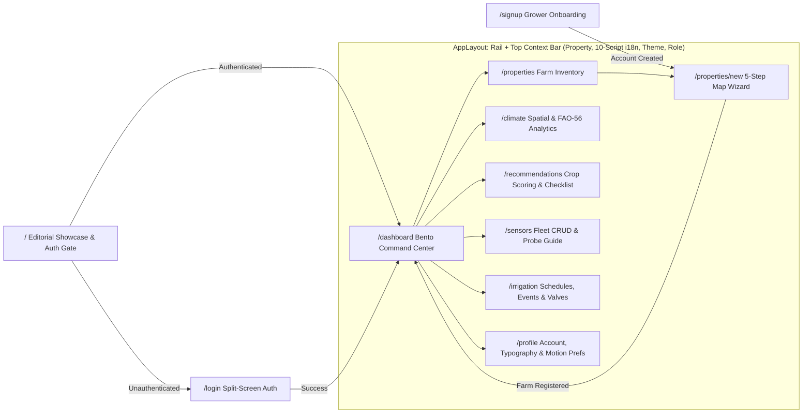

# AgriTech Frontend Masterpiece — Architecture, Design & Skill Orchestration Specification

**Date:** 2026-11-23  
**Project:** `C:\Users\anjan\Downloads\SOA-Hackthon\frontend`  
**Status:** Approved Architecture Spec (Ready for Task-by-Task Implementation)

---

## 1. Frontend Council v5.0 Design Read, Dials & Harmonization

- **Design Read:** `Reading this as: Precision AgriTech Operations & Climate Intelligence Platform for Indian farmers and farm administrators, with Tactile Agrarian Atelier (warm archival cream-and-olive editorial + machined 3D hardware controls & subtle liquid-brass craft), using Next.js 16 + React 19 + Tailwind CSS v4 + Radix UI + Motion + @paper-design/shaders-react.`
- **Design Dials:** `VARIANCE 7/10 · MOTION 6/10 (Silk primary seed + Spring tactile press) · DENSITY 6/10`
- **Archetype Blend:** **Editorial Studio** (`hallmark` warm cream/olive floor + typography) + **Tokenized App Shell** (Radix UI + Tailwind v4 accessible operational console) + **Spatial Showcase** (`/` and `/login` hero craft with `@paper-design/shaders-react` and Double-Bezel trays).

### Harmonizing Project Rules with Agency-Grade Craft
1. **Preserve Domain Identity (`AgriTech-Frontend-Design-Rules.txt`)**: Keep `#FDFBD4` warm archival paper light canvas, `#545333` deep olive ink/accent, `#D9D7B6` khaki hairlines, `#1C1C12` nocturnal dark mode, `Crimson Text` serif headings, `DM Sans` UI copy, `DM Mono` tabular identifiers, 11 languages across 10 Indic/Latin scripts (`frontend/src/lib/i18n.tsx`), authentic human-free Indian agricultural landscape/hardware photography (`hero-field.jpg`, `aerial-farm.jpg`, `soil-sensing.jpg` style), and strict Spring Boot REST contracts (`frontend/src/lib/api.ts`).
2. **Enforce Strict "Project-Style, Zero Humans" Imagery Policy**: Never keep humans, people, faces, hands, or silhouettes in any selected, reused, or generated image. Remove `smart-farming.jpg` and `smart-farming.png` (which depict a farmer and field workers), replace the existing `src="/images/smart-farming.jpg"` reference in `FarmerRecommendationCard.tsx:108`, and model every slot strictly on golden-hour cultivated fields, aerial land mosaics, precision irrigation rows, and matte-black field probes.
3. **Eliminate Conflicting Legacy Artifacts**: Purge all leaked `"GCS Guard"` branding visible in earlier screenshots, remove unused duplicate `.png` files in `frontend/public/images/`, and isolate the untouched Vite directory `frontend/frontend/` as non-active legacy scaffolding.
4. **Elevate Tactile & Spatial Craft**: Upgrade flat controls into physical machined keycaps (`<TactileButton />`), wrap high-priority regions in Double-Bezel trays (`<BezelCard />`), render the custom Furrow-Leaf-Node emblem through `<LiquidMetalLogo />` on `/` and `/login`, keep all operational charts and tables on solid matte paper surfaces, and enforce WCAG 2.2 AA compliance across every screen.

---

## 2. Verified Graphify Baseline & Live Defect Inventory

Graphify AST extraction on `frontend/src` (`39` TypeScript/TSX/CSS source files) recorded `203` nodes, `446` edges, and `8` communities (`0` import cycles).

### Live Defects Identified in Current Code
| ID | File & Line | Defect | Required Resolution |
|---|---|---|---|
| `BUG-01` | `frontend/src/app/dashboard/page.tsx:94,101` | Reads `stats.meanTemp` and `stats.totalRainfall`, which do not exist on `ClimateStats` (`frontend/src/lib/climate.ts:75-97` exports `avgTempC`, `avgPrecipMm`, `todayRainMm`, `et0Total`). Hardcodes Delhi lat/lon (`28.6139, 77.2090`) and static `"Good morning"`. | Switch to `stats.avgTempC` and `stats.et0Total` / `stats.avgPrecipMm`, bind coordinates to `ActivePropertyProvider`, localize greeting via `useLanguage()`. |
| `BUG-02` | `frontend/src/app/globals.css:136-140` | Unlayered `* { box-sizing: border-box; margin: 0; padding: 0; }` placed after `@import "tailwindcss";` overrides `@layer utilities` (`p-*`, `m-*`, `px-*`, `py-*`). | Wrap reset inside `@layer base { ... }` so Tailwind v4 spacing utilities apply reliably. |
| `BUG-03` | `frontend/src/app/sensors/page.tsx:127` & `frontend/src/app/properties/new/page.tsx:269` | Appends hex alpha directly to CSS variables (`"${STATUS_COLOR[s.status]}18"` -> `"var(--status-good)18"`), producing invalid CSS fills. | Replace with `color-mix(in oklch, var(--status-good) 14%, transparent)`. |
| `BUG-04` | `Button.tsx`, `Form.tsx`, `RootZoneSoilCard.tsx`, `LanguageSelectorPill.tsx`, `climate/page.tsx` | Hardcoded Tailwind light colors (`bg-green-700`, `bg-white`, `border-gray-300`), raw hexes (`#545333`, `#2A2919`, `#ECEAD0`, `#D97706`, `#3B82F6`), and `fontSize: 10` Recharts labels break dark mode and legibility. | Refactor all colors to semantic `:root`/`.dark` CSS tokens and raise chart axis/legend text to `>= 12px`. |
| `BUG-05` | `sensors/page.tsx:72`, `login/page.tsx`, `AppLayout.tsx`, `recommendations/page.tsx:84`, `properties/new/page.tsx:266` | `"Add sensor"` lacks `onClick`; `/login` is a flat `max-w-sm` card without demo fill, language pill, or `aria-describedby`; `AppLayout` lacks theme toggle, language switcher, and active farm selector; UI uses raw emojis (`r.crop.emoji`, `📍`). | Wire modal CRUD (`sensorApi.register`), build 55/45 split-screen Auth shell, wire global header controls, replace UI emojis with Lucide/SVG glyphs. |

### Seven Orphaned Components Recovered by Graphify
All 7 components below exist in `frontend/src/components/` with zero imports from `frontend/src/app/`:
1. `FarmAerialSurvey.tsx` (191L) — Interactive drone NDVI zone survey.
2. `FarmerRecommendationCard.tsx` (481L) — 5-tab FAO-56 agronomic advisory and daily checklist.
3. `FarmGoogleMap.tsx` (302L) — Google Maps acreage & spatial field wrapper.
4. `FarmMap.tsx` (585L) — Dual Leaflet / Google Maps locator with geocoding search and weather chip.
5. `LanguageSelectorModal.tsx` (357L) — 10-script typography specimen modal.
6. `LanguageSelectorPill.tsx` (34L) — Compact language/script badge trigger.
7. `RootZoneSoilCard.tsx` (164L) — Dielectric soil moisture and root-zone temperature readout.

---

## 3. Complete Frontend Skills Analysis & Role Matrix

Every frontend, motion, research, and engineering skill installed in the workspace has a defined responsibility across the Login page and overall UX.

### A. Aurelia — Aesthetic Direction, Chromatics, Logos & Backgrounds
| Skill | Core Capability | Role on Login Page (`/login`) | Role Across Overall Frontend UX | Status |
|---|---|---|---|---|
| `high-end-visual-design` | Creative Variance Engine, Double-Bezel nested hardware shells, macro-whitespace, Absolute Zero anti-slop ban. | Frames the login card inside a Double-Bezel archival tray and the right showcase with an Offset Slab + `min-h-[100dvh]`. | Enforces Double-Bezel KPI/feature trays, tactile button-in-button trailing wells, and clean mobile collapse `< 768px`. | **Active** |
| `design-taste-frontend` | 1-line Design Read and 3-Dial (`VARIANCE`, `MOTION`, `DENSITY`) visual calibration. | Calibrates `7/10` visual asymmetry on the 55/45 split login without cluttering form inputs. | Keeps density balanced (`6/10`) between `/` editorial showcase and `/climate` or `/sensors` data tables. | **Active** |
| `hallmark` | Warm paper floor rules, single container width, zero card-in-card nesting, no raw literals past `:root`, `sloplint.mjs --render`. | Ensures the login headline, benefit sentence, and primary sign-in CTA sit above the `1280x800` fold with zero eyebrow clutter. | Governs semantic `:root` tokens, `overflow-x: clip`, `minmax(0, 1fr)` grids, and pre-ship `sloplint.mjs` verification. | **Active** |
| `liquid-logo` | Real-time WebGL liquid-metal shader mask over transparent SVG via `@paper-design/shaders-react` (`speed=0` fallback). | Renders the interactive brushed-brass/olive Furrow-Leaf crest (`<LiquidMetalLogo />`) atop the Auth showcase panel. | Renders animated liquid-metal crest on `/` landing hero while falling back cleanly to static crisp SVG in `AppLayout` sidebar and reduced-motion. | **Active** |
| `dither-fx` | Ordered Bayer matrix, subtle SVG `feTurbulence` tactile paper grain, vintage halftone overlays. | Adds a fixed `0.022` opacity archival paper grain overlay on the cream/nocturnal split background (`pointer-events: none`). | Replaces sterile flat white/gray surfaces with warm tactile field-report paper texture across all operational views. | **Active** |
| `ui-gradients` | OKLCH multi-stop interpolation, directional mesh spotlights, gradient rim borders. | Drives the warm olive/amber directional ambient spotlight and WCAG scrim gradient over `hero-field.jpg`. | Supplies dark/light radial washes in `globals.css` (`in oklch`) and subtle active border highlights without purple/blue SaaS cliché gradients. | **Active** |
| `open-higgsfield-ai` | Cinema Studio physical camera/lens optics prompt engineering for photorealistic assets. | Audits `hero-field.jpg` lighting/composition inside the Offset Slab auth panel (human-free landscape + solar telemetry mast). | Defines physical Cinema Studio prompts (`no people, no farmer, no hands, no silhouettes`) for human-free `crop-canopy.webp` (`/recommendations`) and `irrigation-drip.webp` (`/signup` & `/irrigation`), matching the golden-hour tone of `hero-field.jpg`, `aerial-farm.jpg`, and `soil-sensing.jpg`. | **Active (Asset Spec)** |
| `web-design-spec` | Cream/olive `#FDFBD4` + `#545333` field-report spec reference. | Aligns login typography (`Crimson Text` + `DM Sans`) and warm paper tones. | Harmonized into `AgriTech-Frontend-Design-Rules.txt` with explicit removal of leaked `"GCS Guard"` branding. | **Active (Harmonized)** |
| `shadergradient` | Three.js / React Three Fiber 3D animated mesh gradient backdrop. | Excluded from `/login` to avoid stacking a second Three.js WebGL context beside `LiquidMetal`. | **Evaluated & Bounded:** Deferred in favor of lightweight Apache-2.0 `@paper-design/shaders-react` `<MeshGradient>` (zero Three.js bundle weight). | **Evaluated & Bounded** |
| `react-three-fiber` | Declarative Three.js (`v9+` required for React 19) with `dpr <= 2`. | Excluded from `/login` so auth loads instantaneously on low-end rural mobile hardware. | **Evaluated & Reserved:** Excluded from core bundle; reserved only for an optional future lazy-loaded 3D parcel elevation module using R3F `v9+`. | **Evaluated & Reserved** |

### B. Gideon — UX Flows, Free OSS Primitives, Accessibility & Copy
| Skill | Core Capability | Role on Login Page (`/login`) | Role Across Overall Frontend UX | Status |
|---|---|---|---|---|
| `ui-ux-pro-max` | Local UX DB (WCAG 2.2 SC 3.3.8 auth, form validation, palettes, chart/nav heuristics). | Mandates visible `<label>`s, `autocomplete`, password-manager & paste support, `onBlur` validation, and `>= 44x44px` hit areas. | Enforces mobile-first grids, chart legends/tables, bottom/drawer single-strategy mobile navigation, and inline form feedback. | **Active** |
| `anti-ui-slop` | Full 6-state contract (`default`, `loading`, `empty`, `error`, `success`, `disabled`), real domain copy, zero dummy metrics. | Models idle, CapsLock hint, invalid email blur, submitting busy state, OWASP-neutral error recovery, and post-login redirect. | Guarantees every route (`/dashboard`, `/sensors`, `/irrigation`, `/climate`, `/recommendations`, `/properties`) handles offline `:8080`, empty farms, and error retry cleanly. | **Active** |
| `better-interfaces` | Concentric radius math ($R_{in} = \max(0, R_{out} - p)$), `tabular-nums`, `clamp()` type, `overflow-x: clip`, WCAG contrast. | Applies concentric Double-Bezel corners (`24px` outer / `18px` inner with `6px` padding), `clamp()` H1, and action-first CTA copy (`"Sign in to field station"`). | Standardizes optical button padding (`padding-inline > padding-block`), `tabular-nums` on sensor/weather tables, and `+30%` Indic text expansion safety. | **Active** |
| `impeccable` | 62 heuristic anti-slop rules, max 3 elevation levels, `:focus-visible` `2px` outline + offset, `distill`/`polish`/`harden` checks. | Audits login contrast (`>= 4.5:1` / `>= 3:1` input outline), bans placeholder-only labels, caps card elevation at 3 levels. | Removes redundant card borders, strips raw emoji badges, enforces semantic heading order (`h1` -> `h2` -> `h3`), and audits P0–P3 defects. | **Active** |
| `deslop` | Plain, concrete copy free of AI hype, filler, and staged contrasts. | Writes crisp benefit statements on the split panel (`"Live root-zone moisture, FAO-56 irrigation scheduling, and role-safe field controls."`). | Cleans microcopy, error guidance, empty states, and documentation across all 8 routes. | **Active** |
| `a11y-debugging` | Live Chromium screen-reader tree, Tab focus order, ARIA landmark, and contrast audit. | Verifies `<main>` vs `<aside>`, `aria-describedby` error links, CapsLock `aria-live`, and `Focus Not Obscured` above mobile keyboards. | Audits mobile drawer focus trap/Escape restoration, chart text-table toggles, and color+icon+word status chips in both themes. | **Active** |
| `astryx` | Meta StyleX `@astryxdesign/core` 174 primitives & 7 built-in themes. | Excluded from `/login`. | **Evaluated & Skipped:** Project already uses Tailwind CSS v4 + Radix UI (`package.json`); mixing Meta StyleX compiler into Turbopack/Tailwind v4 creates duplicate token pipelines. | **Evaluated & Skipped** |

### C. Zephyr — Motion Choreography, 3D Tactile Controls, Scroll & Hardware Framing
| Skill | Core Capability | Role on Login Page (`/login`) | Role Across Overall Frontend UX | Status |
|---|---|---|---|---|
| `motion-dev` | MIT `motion/react` (`MotionConfig`, `AnimatePresence`, `layoutId`, `useSpring`, `useMotionTemplate`). | Powers magnetic spring primary CTA option, `AnimatePresence` role/demo pill swap, and radial hover spotlight on the auth tray. | Drives `layoutId` active navigation indicator in `AppLayout`, sliding tab pills in `FarmerRecommendationCard`, and route reveal choreography under `<MotionConfig reducedMotion="user">`. | **Active** |
| `emil-design-eng` | Custom easing tokens (`--ease-out`, `--ease-drawer`), `< 300ms` UI ceiling, `0ms` shortcuts, `:active` `scale(0.97)` press physics, interruptible CSS transitions. | Calibrates tactile button press (`75ms` down / spring release), password eye-toggle transition (`150ms`), and instant input focus feedback. | Bans `transition: all` and `ease-in` across the entire app, tunes drawer timing (`240ms --ease-drawer`), and removes animation from rapid keyboard actions. | **Active** |
| `design-spells` | Signature micro-interactions and subtle haptic delight (`wiggle`, `pop-in`, `hold-to-confirm`). | Executes subtle horizontal `wiggle` on failed login validation and `pop-in` checkmark when demo credentials auto-populate. | Powers `clip-path` hold-to-delete sensor safety trigger (`2s` hold / `200ms` release), copy-coordinate confirmation, and live telemetry beacon pulse. | **Active** |
| `ui-motion` | Single product personality seed (`Silk` default + `Spring` tactile CTA press + named keywords). | Locks `Silk` entrance (180–260ms, no bounce on auth errors) + `Spring` tactile press on `<TactileButton />`. | Enforces one coherent motion language (`Silk` + `Spring`) across modals, tabs, and wizard steps; forbids animating KPI numbers into view. | **Active** |
| `motion-canvas` | Vector SVG `stroke-dashoffset` draw choreography and signal-aligned sequencing. | Draws the Furrow-Leaf-Node vector paths cleanly on initial auth mount (skipped when reduced-motion is on). | Animates irrigation valve schematic flow lines and SVG field-boundary draw on `/properties/new`. | **Active** |
| `mockup-studio` | Realistic 2D browser/device window framing with studio lighting and rim highlights. | Frames the live telemetry preview card nested in the `/login` Offset Slab showcase panel. | Frames the full-fidelity AgriTech dashboard showcase inside crisp browser/phone hardware chrome on the `/` editorial landing page. | **Active** |
| `gsap-scrolltrigger` + `scroll-experience` | Free GSAP 3.13+ (`ScrollTrigger`, `SplitText`, `Flip`) + Lenis smooth scroll without layout thrash. | Excluded from `/login` (auth page fits cleanly inside `100dvh` with zero scroll choreography). | **Scoped to `/` Landing Showcase:** Lenis + `ScrollTrigger` + `SplitText` animate the 3-stage precision farming scroll narrative on `/`; explicitly disabled inside operational dashboard pages to keep data tables/maps instant. | **Active (Scoped to `/`)** |
| `fixing-motion-performance` | GPU-compositor enforcement (`transform`, `opacity`, `clip-path`), zero layout thrash, `IntersectionObserver` pausing, blur `< 8px` limits. | Pauses `<LiquidMetalLogo />` & `<MeshGradient>` WebGL RAF when off-screen via `IntersectionObserver`; keeps blur strictly on fixed overlays. | Pre-ship grep & DevTools gate banning `transition: all`, `width`/`height`/`top`/`left` keyframes, scroll-loop `getBoundingClientRect()`, and excessive promoted layers. | **Active** |

### D. Miranda & Engineering Process — Verification, Knowledge Graph, Research & Security
| Skill | Core Capability | Role on Login Page (`/login`) | Role Across Overall Frontend UX | Status |
|---|---|---|---|---|
| `frontend-council` | 4-persona deliberation, `free_ui_libraries.md`, `bg_selector.py` 4-tier asset selector, live QA & memory sync. | Orchestrates Split-Screen Auth consensus, scrim ratios, zero-humans visual audit, and Playwright verification. | Governs cross-route token consistency, strict no-humans photo curation (`no people/hands/silhouettes`), free OSS licensing (`MIT`/`Apache-2.0`/`ISC`), and updates `~/.gemini/antigravity/knowledge/agents/*.json`. | **Active** |
| `playwright` + `review-ui-states` | Headless/headed Chromium tests across `1280x800` & `390x844`, `naturalWidth > 0`, `scrollWidth <= innerWidth`, state matrix screenshots. | Captures and verifies login idle, blur error, CapsLock hint, offline `:8080` error alert, demo fill, and mobile keyboard above-the-fold visibility. | Executes E2E suite across all 8 routes in Light/Dark + English/Hindi/Telugu with `0` console/page errors, `>= 44px` target assertions, and screenshot verification confirming zero humans in every image. | **Active** |
| `chrome-devtools` + `debug-optimize-lcp` | Live LCP timing, heap/GPU layer profiling, cookie/JWT boundary inspection. | Measures LCP of `hero-field.jpg` (`fetchPriority="high"`) and WebGL canvas FPS on `/login`. | Verifies zero memory leaks when switching routes with Leaflet/Recharts/Shaders mounted. | **Active** |
| `mirofish` | Multi-agent user simulation (`Power User`, `First-Time Novice`, `Accessibility/Screen-Reader User`, `Adversarial Skeptic`). | Simulates rural first-time farmer + screen-reader user + pentester attempting login flows and produces ranked P0–P3 findings. | Exercises full end-to-end onboarding -> dashboard -> irrigation -> sensor registration flow post-build before final sign-off. | **Active** |
| `agent-reach` | Multi-platform web/GitHub JSON reader used in planning/research. | Verified WCAG 2.2 SC 3.3.8 auth standards, IBM/Dell split-login ergonomics, and `@paper-design/shaders-react` React 19 compatibility. | Verified two-layer 3D push-button CSS/Motion architecture and Exa design-engineering references. | **Active (Research)** |
| `graphify` | Local AST knowledge graph (`graphify-out/`) & orphan/god-node impact analysis. | Identified `/login` community edges and `useAuthStore` (18 edges) as top God Node. | Surfaced all 7 orphaned components and guides incremental `graphify update .` validation after refactoring. | **Active** |
| `writing-plans` + `writing-skills` | Bite-sized verifiable TDD implementation plans + RED-GREEN-REFACTOR skill authoring. | Decomposes `/login` + AuthSplitShell into Task 5 with exact Playwright assertions. | Structures Tasks 1–11 for UI execution and Task 12 to author & pressure-test `.agents/skills/agritech-frontend-craft/SKILL.md`. | **Active** |
| `ponytail` + `andrej-karpathy` + `security-audit` | Minimal surgical diffs, caller-grep discipline, security boundary verification. | Enforces OWASP-neutral login error handling, password-manager compatibility, and zero hardcoded JWT secrets. | Reviews RBAC UI gating, prevents XSS (`dangerouslySetInnerHTML`), audits tile/API origins, and requires fresh command verification sign-off. | **Active** |

---

## 4. Visual Pillar Specifications

### A. Color Tokens (`frontend/src/app/globals.css`)
All colors originate strictly inside `:root` and `.dark` blocks; zero raw hex values may appear in TSX or module styles.

| Token | Light ("Sunlit Field Report") | Dark ("Nocturnal Field Station") | Usage |
|---|---|---|---|
| `--bg-base` | `#FDFBD4` | `#1C1C12` | Primary page canvas with archival grain |
| `--bg-surface` | `#FFFEF0` | `#25251A` | Primary card inner core, forms, charts |
| `--bg-raised` | `#F2F0CA` | `#2F2F22` | Input fills, raised popovers, table stripes |
| `--bg-bezel` | `#EBE9BE` | `#16160E` | Outer Double-Bezel tray enclosure |
| `--text-primary` | `#2A2919` | `#FDFBD4` | Headings, active labels, KPI figures (`>= 7:1`) |
| `--text-secondary` | `#545333` | `#D9D7B6` | Helper copy, subtitles, metadata (`>= 4.5:1`) |
| `--border-default` | `#D9D7B6` | `#3A3A2A` | Hairline dividers and card rings |
| `--border-strong` | `#878672` | `#878672` | Input outlines (`>= 3:1` non-text contrast) |
| `--accent` | `#545333` | `#D9D7B6` | Primary 3D button face, active nav, focus rings |
| `--accent-hover` | `#3E3D25` | `#FDFBD4` | Hover face shift |
| `--accent-wash` | `#ECEAD0` | `#343324` | Active row/chip tint |
| `--accent-brass` | `#C69B3A` | `#DFB75A` | Brushed metallic highlight in `LiquidMetalLogo` & top-pick seals |
| `--on-accent` | `#FDFBD4` | `#1C1C12` | High-contrast label ink atop `--accent` |
| `--block` | `#878672` | `#545333` | Decorative Offset Slab behind `/login` & `/` feature panel only |
| `--status-good` | `#435920` | `#B8D47C` | Online / Optimal field state (paired with icon + word) |
| `--status-warning` | `#8F5A08` | `#E3B341` | Attention / Stale / Low battery |
| `--status-critical` | `#B3261E` | `#F0756D` | Offline / Critical / Failed |
| `--status-info` | `#2F6384` | `#74B0D6` | Moisture / Rainfall / Scheduled |
| `--status-muted` | `#6B6A55` | `#A9A890` | Idle / Unavailable |

Badges and alert banners derive fills via `color-mix(in oklch, var(--status-*) 14%, var(--bg-surface))` and borders via `color-mix(in oklch, var(--status-*) 32%, transparent)`.

### B. Logo Design System
1. **Master Mark (`frontend/public/logo-mark.svg`)**: Single-color crisp geometric vector (`viewBox="0 0 64 64"`, transparent background, 20% inner margin) uniting **3 parallel contour furrow lines** emerging into an **asymmetric botanical leaf** anchored by a **precision telemetry node dot** at the stem base.
2. **Hero / Auth Liquid Crest (`<LiquidMetalLogo />`)**: Powered by `@paper-design/shaders-react` `<LiquidMetal>` masking `/logo-mark.svg`.
   - Palette: `colorBack="#1C1C12"`, `colorTint="#DFB75A"` (dark) or `colorBack="#2A2919"`, `colorTint="#C69B3A"` (light); `repetition={2}`, `softness={0.18}`, `distortion={0.06}`, `contour={0.38}`, `speed={0.45}`, `minPixelRatio={1}`, `maxPixelCount={1920 * 1080}` (capped `dpr <= 2`).
   - **Performance & Accessibility Guards**: `IntersectionObserver` sets `speed={0}` when scrolled off-screen; `useReducedMotion()` forces static `speed={0}` frame; wrapped in React ErrorBoundary + CSS static `` fallback if WebGL context creation fails.
3. **Operational Shell Logo (`<AgriTechLogo />`)**: Pure SVG stroke-draw version (`motion-canvas` `stroke-dashoffset` draw over `450ms` on mount when motion is allowed, crisp static SVG thereafter) used in `AppLayout`, `/properties`, `/sensors`, and print reports.

### C. 3D Tactile Button System (`<TactileButton />` & `<HoldConfirmButton />`)
Grounded in two-layer hardware keycap physics (`agent-reach` research + `emil-design-eng` + `high-end-visual-design`):
- **DOM Structure**:
  - Outer `<button>` (interactive target, `min-h-[44px]` desktop / `min-h-[48px]` mobile, `rounded-full` or `rounded-[14px]` for compact toolbar controls, `focus-visible:outline-2 focus-visible:outline-offset-4 focus-visible:outline-[var(--accent)]`).
  - **Ledge Layer (``)**: Fixed seat anchored to bottom, darkened via `background: color-mix(in oklab, var(--btn-face) 56%, #0d0d08)`, carrying the ambient cast shadow (`0 6px 14px -4px rgba(28, 28, 18, 0.28)`). Putting the shadow on the ledge prevents Tailwind/CSS box-shadow rules from clipping `:focus-visible` outlines.
  - **Floating Face Layer (``)**: Raised by `var(--btn-depth)` (`5px` md, `6px` lg, `4px` sm), inner top specular edge (`inset 0 1px 0 rgba(255,255,255,0.28)`), optical horizontal padding (`px-6 py-3` md, `px-5 py-2.5` sm).
- **Physics & States**:
  - **Hover** (`@media (hover: hover) and (pointer: fine)`): lifts `+1.5px` (`150ms cubic-bezier(0.23, 1, 0.32, 1)`).
  - **Press (`:active`)**: sinks down onto the ledge (`translateY(calc(var(--btn-depth) - 1px)) scale(0.985)` in `75ms ease-out`).
  - **Button-in-Button Variant (`trailingIcon`)**: Right-aligned circular socket (`w-7 h-7 rounded-full bg-white/15`) that shifts diagonally (`translate-x-0.5 -translate-y-0.5`) on hover.
  - **Magnetic CTA Option (`magnetic`)**: Opt-in `useMotionValue` + `useSpring({ stiffness: 300, damping: 20, mass: 0.6 })` enabled only on `/` and `/login` hero CTAs (disabled on dense operational tables and under reduced motion).
  - **All 6 UX States**: `default`, `loading` (fixed button width preserved via grid overlay + spinner + action verb e.g. `"Signing in…"`), `disabled` (muted ledge depth `2px`, visible border + `cursor-not-allowed`, contrast maintained), `success` (short checkmark crossfade), `error` (critical border + label), and `HoldConfirmButton` (destructive actions like deleting a sensor/property fill via `clip-path: inset(0 100% 0 0)` over `1.8s` linear hold and snap back in `200ms var(--ease-out)` on early release, plus click fallback with accessible confirm dialog).

### D. 4-Tier Background & Image System

> **Strict Image Selection Rule ("Project-Style, Zero Humans"):** Every photograph or generated scene MUST match the warm golden-hour agricultural landscape, drone field patchwork, and macro matte-hardware visual language established by `hero-field.jpg`, `aerial-farm.jpg`, and `soil-sensing.jpg`. **Never include humans, farmers, faces, hands, or silhouettes** in any selected, reused, or generated image.

1. **Tier 1 — Project-Matched Human-Free Visuals (`open-higgsfield-ai` / `image-generator`)**:
   - `frontend/public/images/crop-canopy.webp` *(replaces `smart-farming.jpg`)* — Golden-hour Cinema Studio mid-macro (`85mm`, `f/2.8`, natural warm morning haze, cultivated golden-green wheat stalks and terraced crop rows, **zero people, zero hands**; fallback: `hero-field.jpg`). Used on `/recommendations` & `FarmerRecommendationCard.tsx:108`.
   - `frontend/public/images/irrigation-drip.webp` — Golden-hour low-angle shot (`35mm`, `f/4`, dark rich mineral loam, matte-black precision drip-irrigation lateral lines with glistening moisture droplets along neat young crop rows, **zero people, zero hands**; fallback: `soil-sensing.jpg`). Used on `/signup` Offset Slab & `/irrigation` header strip.
   - Every generated image MUST be visually inspected via `read_file` before committing to verify `0` human figures and consistent natural lighting.
2. **Tier 2 — Approved Existing Human-Free Project Photos (Retain 3, Purge Deprecated & Duplicates)**:
   - `frontend/public/images/hero-field.jpg` -> `/login` right Offset Slab hero + `/` landing Hero (`fetchPriority="high"`, eager LCP, warm dark-olive gradient scrim ensuring `>= 4.5:1` / `>= 7:1` copy contrast; misty golden-hour wheat hills + solar weather mast, **zero humans**).
   - `frontend/public/images/aerial-farm.jpg` -> `/dashboard` (`FarmAerialSurvey` interactive NDVI zone canvas) & `/properties` illustrative cover fallback (clearly badged `"Illustrative image"`; aerial river + pivot crop patchwork, **zero humans**).
   - `frontend/public/images/soil-sensing.jpg` -> `/sensors` hardware placement reference drawer/guide card + `RootZoneSoilCard` hardware backdrop (**zero humans**, never behind live sensor tables).
   - **Mandatory Removal & Reference Purge**: Delete `smart-farming.jpg` and `smart-farming.png` (which contain a foreground farmer and background people), replace `src="/images/smart-farming.jpg"` in `FarmerRecommendationCard.tsx:108` with `MEDIA_MANIFEST["crop-canopy"].src`, and delete all unused duplicate `.png` files (`hero-field.png`, `aerial-farm.png`, `soil-sensing.png`) to eliminate ~4–8 MB bundle bloat. Every remaining `` declares explicit `width`/`height` or `aspect-ratio`, `decoding="async"`, factual `alt`, and zero CLS.
3. **Tier 3 — Live WebGL Canvas (`@paper-design/shaders-react`)**: Subtle warm olive-amber `<MeshGradient>` softly layered behind the `/` landing hero and `/login` right showcase bezel (`opacity: 0.35`, `pointer-events-none`, paused off-screen & under reduced-motion). Never placed on `/dashboard`, `/climate`, `/sensors`, or `/irrigation`.
4. **Tier 4 — Zero-KB CSS/SVG Surfaces (Default for Operational Workspace)**:
   - `.bg-archival-grain` (`dither-fx`): fixed `pointer-events: none` SVG `feTurbulence` paper noise at `0.022` opacity.
   - `.bg-topographic-field`: fine CSS/SVG elevation contour lines + coordinate ticks (`mask-image` radial fade) behind `AppLayout` shell header and empty states.
   - `.bg-oklch-wash` (`ui-gradients`): soft directional radial wash (`in oklch`) behind page headers; **charts strictly sit on solid `--bg-surface` paper**.

### E. Animation & Motion Architecture
- **Motion Seed**: `Silk` (smooth, composed `cubic-bezier(0.23, 1, 0.32, 1)`) paired with `Spring` exclusively for `<TactileButton />` physical press and `layoutId` active navigation/tab pills.
- **Timing Budget**: `75ms` button press · `150ms` hover/focus · `180–240ms` popovers/drawers (`--ease-drawer: cubic-bezier(0.32, 0.72, 0, 1)`) · `0ms` keyboard shortcuts · `400ms` Sonner-style toasts · `650–800ms` `/` scroll narrative only.
- **Strict Performance & Accessibility Rules**:
  - Root layout wraps app in `<MotionConfig reducedMotion="user">`.
  - GPU properties only (`transform`, `opacity`, `clip-path`). Zero `transition: all`, zero `ease-in`, zero animating `width`/`height`/`top`/`left`, zero `scale(0)` entrances (start from `scale(0.95)`).
  - Lenis + GSAP 3.13+ (`ScrollTrigger`, `SplitText`) load dynamically (`ssr: false`) **only on `/`** so operational routes stay lightweight.

---

## 5. Best Login Page (`/login`) & Signup (`/signup`) UX Blueprint

Designed against `ui-ux-pro-max` WCAG 2.2 AA SC 3.3.8, IBM Carbon split-auth ergonomics, and `AgriTech-Frontend-Design-Rules.txt`:

1. **Responsive Geometry (`AuthSplitShell`)**:
   - Desktop (`>= 960px`): 55% left `<main>` workspace (clean cream `#FDFBD4` / nocturnal `#1C1C12` paper + subtle top-right `<LanguageSelectorPill />` & Theme toggle) paired with 45% right `<aside>` Offset Slab showcase (`24px` offset `--block` slab behind `24px` rounded photo/shader frame).
   - Mobile (`< 960px`): Right decorative panel hides cleanly (`hidden lg:flex`), and email + password + primary `<TactileButton />` sit cleanly in the top `520px` so mobile virtual keyboards never obscure the Sign-in button (WCAG 2.2 SC 2.4.11).
2. **Accessible Form Ergonomics (Left `<main>`)**:
   - Header bar: `<AgriTechLogo />` + `<LanguageSelectorPill />` + Dark/Light toggle.
   - Semantic `<h1>` (`"Sign in to your field station"`) + concise 1-sentence subtitle (`"Monitor soil moisture, weather forecasts, and automated irrigation from one console."`).
   - Double-Bezel form tray (`<BezelCard variant="tray">`) holding:
     - **Email (`id="email"`)**: persistent `<label>`, `autocomplete="email"`, paste allowed, `onBlur` Zod format check, `aria-invalid`, `aria-describedby="email-error"`.
     - **Password (`id="password"`)**: persistent `<label>`, `autocomplete="current-password"`, paste allowed, live `CapsLock` indicator (`aria-live="polite"`), `44x44px` show/hide toggle button with `aria-label`, `"Forgot password?"` inline popover guidance (instructing admin reset / demo account use without leaving dead links).
     - **OWASP-Neutral Error Banner**: `role="alert"`, critical 8% surface + `AlertTriangle` icon + subtle `wiggle` on failed submit, never leaks whether an email exists.
     - **Primary 3D CTA**: `<TactileButton variant="primary" size="lg" magnetic loading={loading} trailingIcon>` (`"Sign in"` / `"Signing in…"`).
   - **Quick Demo Access Strip** (below primary CTA, collapsible/clean cards matching `JUDGE-DEMO.md`):
     - Two secondary `<TactileButton size="sm" variant="secondary">` quick-fill buttons (`"Fill Admin Demo"` -> `admin@agritech.io` / `admin1234`, `"Fill Farmer Demo"` -> `farmer@agritech.io` / `farmer1234`) with `"Populated"` `pop-in` badge, plus direct link to `/signup` (`"New grower? Create farm account"`).
3. **Showcase Panel (Right `<aside>`)**:
   - Offset `--block` slab (`border-radius: 32px`) behind a `24px` front card displaying `hero-field.jpg` on `/login` (`irrigation-drip.webp` with `soil-sensing.jpg` fallback on `/signup`, strictly zero humans) with `fetchPriority="high"`, dark-olive gradient scrim, `<LiquidMetalLogo />` crest at top-left, `<h2>` (`"Every field, sensor, and valve on one calm report."`), and a `mockup-studio` miniature live telemetry bezel card showing sample FAO-56 / soil capacitance readout labeled `"Illustrative station telemetry"`.
4. **Signup Page (`/signup`)**: Shares `<AuthSplitShell>` using human-free `irrigation-drip.webp` (fallback `soil-sensing.jpg`), matching password strength meter (visual bar + requirement checklist, not color alone), role defaults to `"FARMER"` (`authApi.register`), and seamless handoff to `/properties/new`.

---

## 6. Page Placement, Route Architecture & Orphan Rewiring Map

### Route-by-Route Placement & Component Wiring
| Route | Role & Layout Archetype | Placed Sections & Rewired Orphaned Components | Imagery / Background Tier |
|---|---|---|---|
| `/` | Editorial Showcase (Unauth) + Fast Redirect Option (Auth) | Hero (`LiquidMetalLogo`, `SplitText` headline, `hero-field.jpg` Offset Slab, magnetic CTAs to `/login` & `/signup`), `mockup-studio` interactive dashboard frame, 3-step `ScrollTrigger` farm telemetry story (Lenis smooth scroll), compact footer crediting Open-Meteo & photography. | Tier 2 (`hero-field.jpg`) + Tier 3 (`<MeshGradient>`) + Tier 4 grain |
| `/login` & `/signup` | 55/45 Split-Screen Auth (`AuthSplitShell`) | Left `<main>`: Double-Bezel form, `TactileButton`, CapsLock & `onBlur` validation, Judge Demo quick-fill, `<LanguageSelectorPill />`, Theme toggle. Right `<aside>`: Offset Slab + `hero-field.jpg` (`/login`) or `irrigation-drip.webp` (`/signup`) + `<LiquidMetalLogo />` + `mockup-studio` telemetry strip. | Tier 1/2 (`hero-field.jpg`, `irrigation-drip.webp` — zero humans) + Tier 3 subtle rim + Tier 4 grain |
| `AppLayout` | Authenticated Shell (Desktop fixed left rail + top context bar; Mobile accessible focus-trapped drawer — NO competing bottom bar) | `<AgriTechLogo />`, `layoutId` active route rail, Active Farm Switcher (`ActivePropertyProvider`), `<LanguageSelectorPill />` + **rewired `<LanguageSelectorModal />`**, Theme `toggle-flip` button, Role badge (`ADMIN` / `FARMER`), localized i18n navigation labels. | Tier 4 archival grain + `.bg-topographic-field` header strip |
| `/dashboard` | Asymmetric Bento Command Center (`VARIANCE 7`, `DENSITY 6`) | 4 KPI Bezel cards (`tabular-nums`, fixing `avgTempC` / `avgPrecipMm` crash), Active Alerts Rail (actionable links to `/irrigation` & `/sensors`), **rewired `<RootZoneSoilCard />`** (refactored to semantic dark/light tokens), **rewired `<FarmAerialSurvey />`** (interactive NDVI zones on `aerial-farm.jpg`), 14-day Climate Summary strip, clean empty-farm CTA. | Tier 2 (`aerial-farm.jpg` inside survey only — zero humans) + Tier 4 grain; KPIs on solid `--bg-surface` |
| `/properties` | 3-Column Farm Inventory Grid (`New Route`) | Property cards (`3:2` illustrative cover if no photo uploaded, area `ha`, water/irrigation badges, active switcher button), `"Add Property"` `TactileButton` -> `/properties/new`, empty & offline fallback states. | Tier 2 (`aerial-farm.jpg` badged `"Illustrative"`) + Tier 4 |
| `/properties/new` | 5-Step Guided Farm Wizard | `AnimatePresence` step transitions: Step 1 **rewires `<FarmMap />`** (click map or search village to auto-fill lat/lon/address alongside inputs), Step 2 Water/Soil tactile chips, Step 3 Crop Intent, Step 4 Sensor plan (Lucide icons instead of `📍`), Step 5 Review & submit via `propertyApi.create`. | Functional Leaflet/Google Map + Tier 4 paper |
| `/climate` | Spatial & FAO-56 Analytics Studio | Farm/Preset selector synced with active property, **rewired `<FarmMap />`** (Leaflet/Google toggle + weather pill), **rewired `<RootZoneSoilCard />`**, 3 solid-surface Recharts panels (Temperature, Rain vs `ET₀`, Water Balance) upgraded to CSS tokens, `>=12px` labels, & `"Show Data Table"` toggle for screen readers. | Functional Map + Solid `--bg-surface` charts |
| `/recommendations` | Agronomic Crop & Field Advisory Hub | Botanical field canopy banner using human-free `crop-canopy.webp`, **rewired `<FarmerRecommendationCard />`** (replacing `smart-farming.jpg` at line 108 with `crop-canopy.webp`, 5-tab `layoutId` advisory + interactive checklist), top-5 climate-scored crops list replacing raw `crop.emoji` with clean botanical Lucide category badges. | Tier 1 (`crop-canopy.webp` strip — zero humans) + Tier 4 solid cards |
| `/sensors` | IoT Fleet CRUD & Hardware Console | Fleet KPI row, searchable/filterable sensor cards (`color-mix()` fixed status badges with icon + word), `"Add sensor"` **wired** to Radix Dialog (`sensorApi.register`), Role-gated (`ADMIN` vs `FARMER` read-only notice), `<HoldConfirmButton />` delete flow, collapsible Hardware Probe Guide with `soil-sensing.jpg`. | Tier 2 (`soil-sensing.jpg` inside collapsible guide only — zero humans) + Tier 4 |
| `/irrigation` | Valve Telemetry & Schedule Control | Schedules & Watering Events columns (solid surfaces, `tabular-nums` volumes/durations), Demo vs Live Hardware clarity banner, `"New Schedule"` action modal (ADMIN-gated), `irrigation-drip.webp` configuration banner & `motion-canvas` animated SVG pipe/valve schematic. | Tier 1 (`irrigation-drip.webp` — zero humans) + SVG schematic + Tier 4 solid cards |
| `/profile` | Account, Typography & Accessibility Center | User identity card (`ADMIN` / `FARMER` capabilities matrix), quick access to 10-script `<LanguageSelectorModal />`, Light/Dark theme picker, Reduced-Motion override preference, session status & Sign out `TactileButton`. | Tier 4 archival surface |

---

## 7. Security Audit & Live QA Acceptance Gates

### Security Boundaries (`security-audit` Guidance Mode)
1. **Authentication & Session Hygiene**: Keep JWT + refresh tokens strictly inside existing `useAuthStore` (`agritech-auth`); permit password managers/paste (WCAG SC 3.3.8); display OWASP-neutral error messages (`"Email or password did not match. Try again or contact your farm administrator."`); never auto-submit demo credentials on mount (user clicks quick-fill intentionally).
2. **RBAC UI Parity**: Gate write UI (`Add sensor`, `Delete sensor`, `New Schedule`, `Edit property`) via `user?.role === "ADMIN"` while keeping Spring Boot gateway enforcement authoritative (never rely on client checks for security).
3. **XSS & Untrusted Inputs**: Zero `dangerouslySetInnerHTML`, zero unescaped query string rendering, Zod validation on all forms, `rel="noopener noreferrer"` on external Google Maps links, and strict static asset paths.

### Live Verification & Quality Gates
- **Typecheck & Production Build**: `npx tsc --noEmit` and `npm run build` in `frontend/` exit `0`.
- **Playwright E2E Suite (`frontend/e2e/masterpiece.spec.ts`)**:
  - Runs at Desktop (`1280x800`), Tablet (`768x1024`), and Mobile (`390x844` + `320x640` reflow) in **Light & Dark modes** and **English, Hindi (`hi`), Telugu (`te`)**.
  - Verifies `0` console/page errors, `document.documentElement.scrollWidth <= window.innerWidth`, all rendered `` (`complete && naturalWidth > 0`), all buttons/links `>= 44x44px` hit height/width on mobile, `<TactileButton>` press state, `/login` `aria-describedby` & Demo fill, and graceful offline `:8080` recovery states.
- **Automated Audits**:
  - `fixing-motion-performance` check: `0` occurrences of `transition: all`, `ease-in`, or `width`/`height`/`top`/`left` keyframe animation.
  - `hallmark` `sloplint.mjs --render` audit across key routes.
  - `a11y-debugging` & `debug-optimize-lcp` check via Chrome DevTools / Playwright accessibility snapshot (`0` critical/serious axe violations).
  - `mirofish` 4-persona simulation report confirming `Advantages & Disadvantages` before final sign-off.
  - `graphify update .` verifying updated component edges and zero unresolved orphans.
