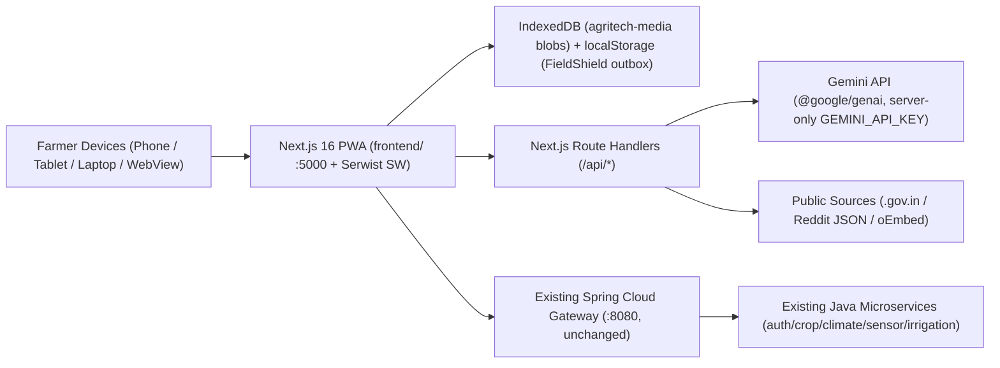
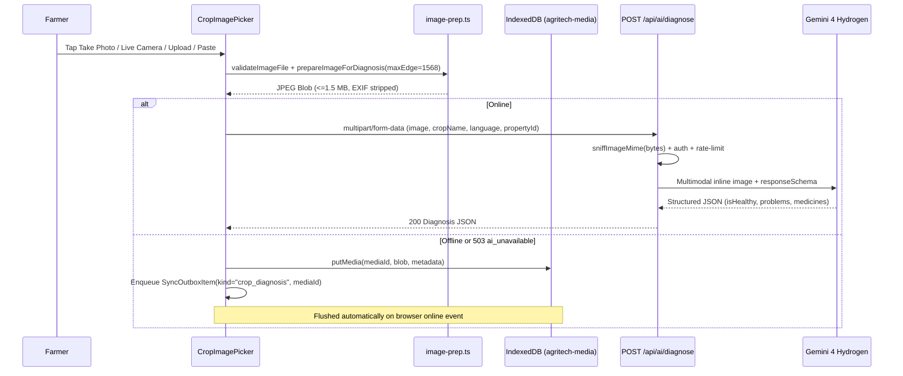

# AgriTech Daily Kisan Companion — Architecture Specification

- **Date:** 2026-11-28
- **Target Workspace:** `frontend/` (Next.js `16.4.6`, React `19.3.0`, TypeScript `5`, Tailwind CSS `4`)
- **Backend Boundary:** Existing Spring Boot microservices (`:8080`, Eureka `:8761`) remain untouched.
- **Related Master Plan:** [2026-11-28-agritech-daily-kisan-companion.md](../plans/2026-11-28-agritech-daily-kisan-companion.md)

---

## 1. Intent, Goals & Non-Goals

### Intent
Transform the existing AgriTech Field Portal (`frontend/`) into an installable, offline-first **Daily Kisan Companion** for Indian smallholder farmers (budget Androids, iPhones, tablets, laptops, 2G/intermittent connectivity, and WhatsApp/Instagram in-app browsers), anchored by a **Universal Media Capture ("Capture Anywhere")** pipeline so farmers can photograph crops or upload leaf/loss photos on any device.

### Goals
- **Capture Anywhere:** Camera and gallery/file upload work reliably across Android Chrome, iOS Safari, standalone PWAs, WhatsApp/Instagram WebViews, tablets, and laptops (with or without a webcam).
- **Offline-First Critical Path:** Daily 6 AM Action Cards, `"Kyun?"` sensor explanations, Kisan Roznamcha logs, cached Mandi/Schemes/State Pulse feeds, 4-factor Truth Score math, and PMFBY 72-hour loss capture function with zero network signal.
- **Honest AI:** Server-side `@google/genai` routes handle multimodal leaf diagnosis, vernacular voice ASR/TTS, and claim verification; if `GEMINI_API_KEY` is missing or unreachable, the UI shows an honest fallback and queues photos/requests locally—never fabricating diagnoses or percentages.
- **11-Language Bharat UX:** Preserve Area Editorial Botanical tokens, `Crimson Text` + `DM Sans` + `DM Mono` (`tabular-nums`), and all 11 Indic locales (`i18n.tsx`), with ≥52 px Simple Farmer Mode tap targets.

### Non-Goals
- No modifications to Java/Spring Boot services (`api-gateway`, `auth-service`, `crop-service`, `climate-service`, `sensor-service`, `irrigation-service`) or `docker-compose.yml`.
- No raw image blobs in `localStorage` or Zustand persistence (`safeStateStorage` ~5 MB cap).
- No live browser-side scraping of `.gov.in` or social portals (CORS/SSRF risk); all external fetches run server-side.

---

## 2. System Context



---

## 3. Layered Architecture

| Layer | Responsibility | Key Files & Modules |
|---|---|---|
| **UI Shell & Navigation** | Daylight/Night editorial theme, `Simple | Full` mode toggle, 5-tab mobile bottom bar, PWA install & offline banner | `AppLayout.tsx`, `PWAInstallButton.tsx`, `OnlineStatusBanner.tsx`, `LocationCascadeSelect.tsx` |
| **Feature Modules** | Daily 6 AM Card, Roznamcha, Mandi Break-Even, Schemes & PMFBY Locker, Truth Shield + Custom Link Verifier, Crop Doctor, Voice, FPO Broadcasts | `SimpleFarmerHome.tsx`, `DailyActionCard.tsx`, `MandiBoard.tsx`, `SchemesAndLocker.tsx`, `StateAgriPulse.tsx`, `CustomLinkVerifier.tsx`, `CropImagePicker.tsx`, `CropDoctorModal.tsx`, `FpoBroadcastPanel.tsx` |
| **Pure Domain Libraries** | Deterministic agronomic, financial, safety, and media prep math (100% unit-testable in Vitest) | `fieldshield.ts`, `daily-briefing.ts`, `roznamcha.ts`, `truth-score.ts`, `url-safety.ts`, `mandi-data.ts`, `schemes-data.ts`, `media-capabilities.ts`, `image-prep.ts`, `image-sniff.ts` |
| **Client Persistence** | Small metadata/state in Zustand `localStorage`; binary image blobs & offline capture queue in IndexedDB | `property-store.ts` (`useFarmStore` + `safeStateStorage`), `media-queue.ts` (`MediaStore` / `agritech-media` IDB) |
| **Service Worker Cache** | Offline app shell precache + stale-while-revalidate runtime cache for GET feeds | `src/app/manifest.ts`, `src/app/sw.ts` (`@serwist/next`) |
| **Server Route Layer** | SSRF-guarded link verification, curated/cached state feeds, multipart image diagnosis, ASR/TTS | `src/app/api/state-pulse/*`, `src/app/api/mandi/route.ts`, `src/app/api/schemes/route.ts`, `src/app/api/ai/*` |

---

## 4. Feature Module Map

| # | Feature | Route / Entry | Components | Pure Lib | API Route | Offline Behaviour | Data Source |
|---|---|---|---|---|---|---|---|
| 1 | **Simple Farmer Mode** | `/dashboard` | `SimpleFarmerHome.tsx` | `property-store.ts` | — | Full offline | `useFarmStore` (`farmerMode`) |
| 2 | **6 AM Action Card & "Kyun?"** | `/dashboard` | `DailyActionCard.tsx` | `fieldshield.ts`, `daily-briefing.ts` | `/api/ai/tts` (opt) | Deterministic + `speechSynthesis` | Active parcel + weather + top mandi |
| 3 | **Kisan Roznamcha** | `/dashboard` (drawer) | `RoznamchaDrawer.tsx` | `roznamcha.ts` | — | Signed locally + outbox | `useFarmStore` + sensor/valve logs |
| 4 | **Mandi & MSP Board** | `/mandi` | `MandiBoard.tsx` | `mandi-data.ts` | `GET /api/mandi` | Cached snapshot + live break-even | Curated APMC/e-NAM dataset |
| 5 | **Schemes & PMKSY Estimator** | `/schemes` | `SchemesAndLocker.tsx` | `schemes-data.ts` | `GET /api/schemes` | Cached + local checklist | Curated central/state schemes |
| 6 | **PMFBY 72-Hr Locker** | `/schemes` | `SchemesAndLocker.tsx`, `CropImagePicker.tsx` | `schemes-data.ts`, `media-queue.ts` | — | GPS + IDB photo + 72h timer | `agritech-media` IDB + `syncOutbox` |
| 7 | **State Agri-Pulse Feed** | `/updates` | `StateAgriPulse.tsx` | `truth-score.ts` | `GET /api/state-pulse/feed` | Cached feed + timestamp | `.gov.in`, KVK, Reddit JSON |
| 8 | **Custom Link Truth Shield** | `/updates` | `CustomLinkVerifier.tsx` | `url-safety.ts`, `truth-score.ts`, `truth-report-image.ts` | `POST /api/state-pulse/verify` | Domain pre-check + PNG render | SSRF-safe extract + Gemini Grounding |
| 9 | **Universal Media Capture** | Shared picker | `CropImagePicker.tsx`, `LiveCameraModal.tsx` | `media-capabilities.ts`, `image-prep.ts` | — | Compress + IDB queue | Device camera / gallery / paste / drop |
| 10 | **Crop Photo Doctor** | Simple Mode, `/recommendations` | `CropDoctorModal.tsx`, `CropImagePicker.tsx` | `image-prep.ts`, `image-sniff.ts`, `media-queue.ts` | `POST /api/ai/diagnose` | Queues photo to IDB + checklist | `gemini-4-hydrogen` structured JSON |
| 11 | **Voice & FPO Broadcast** | Drawer + `/dashboard` | `VoiceCompanionDrawer.tsx`, `FpoBroadcastPanel.tsx` | `daily-briefing.ts` | `/api/ai/transcribe`, `/api/ai/tts` | Web Speech API + `wa.me` share | `gemini-3.5-transcribe` + parcel list |

---

## 5. Universal Media Capture ("Capture Anywhere") Architecture

### 5.1 Four Entry Points in `CropImagePicker.tsx`
`CropImagePicker` is shared by **Crop Photo Doctor** and the **PMFBY 72-Hr Evidence Locker**. It never assumes a webcam or `getUserMedia` exists:

1. **Take Photo (Primary on Mobile/Tablet/In-App Browsers):**
   - Renders `<input type="file" accept="image/*" capture="environment">`.
   - Opens the OS native camera directly with zero JavaScript permission dialogs; works inside WhatsApp, Instagram, and Android WebViews; desktop browsers automatically ignore `capture` and open a standard file chooser.
2. **Live Camera (Opt-In Viewfinder for Laptop Webcams & Tablets):**
   - Rendered **only** when `detectCaptureCapabilities()` reports `hasGetUserMedia && isSecureContext`.
   - Opens `LiveCameraModal.tsx` calling `navigator.mediaDevices.getUserMedia({ video: { facingMode: { ideal: facingMode } }, audio: false })` with **no resolution, aspect-ratio, or frame-rate constraints** (avoids mobile sensor cropping and silent `applyConstraints` failures).
   - Captures via `<canvas>` `drawImage(video)` → `canvas.toBlob("image/jpeg", 0.85)`.
   - Stops every `MediaStreamTrack` immediately on capture, modal close, component unmount, and `document.visibilitychange` (`hidden`). Supports front/back camera flip by cycling `facingMode` (`"environment"` ↔ `"user"`).
3. **Upload from Gallery / Files (Universal Fallback):**
   - Renders `<input type="file" accept="image/jpeg,image/png,image/webp,image/heic,image/heif">` without `capture`, allowing farmers to pick an existing photo from WhatsApp Downloads, Gallery, or laptop folders.
4. **Drag-and-Drop + Clipboard Paste (`Ctrl/Cmd+V`) (Desktop/Laptop):**
   - Enabled when `!coarsePointer` (`matchMedia("(pointer: fine)")`), letting agronomists or laptop users drop a leaf photo or paste a screenshot directly into the picker.
5. **Review Gate:** Every entry path feeds a unified preview step (**Use Photo** / **Retake**) before compression and upload/queueing.

### 5.2 Capability Detection (`media-capabilities.ts`)
Pure, dependency-injected helper so Vitest can test every environment matrix without mocking globals:
```ts
export interface CaptureEnvironment {
  hasMediaDevices: boolean;
  isSecureContext: boolean;
  coarsePointer: boolean;
  supportsShareFiles: boolean;
  isStandalonePwa: boolean;
}

export function detectCaptureCapabilities(env: CaptureEnvironment) {
  return {
    showTakePhotoCapture: true,
    showUploadFile: true,
    showLiveCamera: env.hasMediaDevices && env.isSecureContext,
    showDropAndPaste: !env.coarsePointer,
    canShareImageFiles: env.supportsShareFiles,
    isStandalonePwa: env.isStandalonePwa,
  };
}
```

### 5.3 `getUserMedia` Error Mapping & Recovery

| Condition / Error | User-Facing Message & Action |
|---|---|
| `NotAllowedError` / `PermissionDeniedError` | *"Camera permission is blocked. Use **Take Photo** or **Upload Photo** below, or enable Camera in your browser site settings."* |
| `NotFoundError` / `DevicesNotFoundError` | Hide **Live Camera** button for the session; keep **Take Photo** and **Upload Photo** active. |
| `NotReadableError` / `TrackStartError` | *"Your camera is busy in another app (such as WhatsApp or Meet). Close it or use **Upload Photo**."* |
| `OverconstrainedError` | Automatically retry once with `{ video: true, audio: false }`; if still rejected, fall back to **Upload Photo**. |
| `!window.isSecureContext` (e.g., phone testing `http://192.168.x.x:5000`) | Hide **Live Camera** automatically; display hint noting **Take Photo / Upload** still work. *(Dev tip: run `next dev --experimental-https` for LAN webcam testing.)* |

### 5.4 Client-Side Image Validation & Compression (`image-prep.ts`)
- **`validateImageFile(file)`:** Rejects `size === 0` (`EMPTY`), `size > 15 * 1024 * 1024` (`TOO_LARGE`), and non-whitelisted MIME types (`UNSUPPORTED_TYPE`; allows `image/jpeg`, `image/png`, `image/webp`, `image/heic`, `image/heif`).
- **`computeTargetSize(width, height, maxEdge = 1568)`:** Pure scaler preserving aspect ratio; images already `<= 1568` on both edges are returned unchanged.
- **`prepareImageForDiagnosis(file, opts)`:**
  1. Decodes via `createImageBitmap(file, { imageOrientation: "from-image" })` to honor mobile EXIF portrait rotation (with `` element fallback on older browsers).
  2. Draws onto an offscreen/HTML `<canvas>` at `computeTargetSize(w, h, 1568)` and encodes `image/jpeg` at quality `0.82` (stepping down to `0.70` if still `> 1_500_000` bytes). Re-encoding through `<canvas>` **strips EXIF/GPS metadata** for farmer privacy (PMFBY location is captured separately via explicit Geolocation consent).
  3. **HEIC Fallback:** If a desktop browser (e.g., Windows Chrome) cannot decode an iPhone `.heic` file in `createImageBitmap`, and `file.size <= 4_000_000`, pass the raw HEIC blob through (Gemini accepts `image/heic` and `image/heif`); if `> 4 MB`, return a localized error asking the user to convert or retake via **Take Photo**.

### 5.5 Device Compatibility Matrix

| Device / Browser | Take Photo (`capture`) | Live Camera (`getUserMedia`) | Upload File | Drag/Paste | Notes |
|---|---|---|---|---|---|
| **Android Chrome** | ✅ Native camera | ✅ HTTPS / localhost | ✅ Gallery | ❌ | Rear camera via `facingMode: "environment"` |
| **Android In-App (WhatsApp / Instagram)** | ✅ Native camera | ⚠️ Often blocked by WebView | ✅ Gallery | ❌ | Take Photo & Upload always succeed |
| **iOS Safari** | ✅ Native camera | ✅ iOS 14.3+ HTTPS | ✅ Photos / Files | ❌ | `createImageBitmap` handles HEIC & EXIF |
| **iOS Standalone PWA** | ✅ Native camera | ✅ iOS 14.3+ | ✅ Photos / Files | ❌ | Ensure `Permissions-Policy: camera=(self)` |
| **iPadOS Safari** | ✅ Native camera | ✅ HTTPS | ✅ Photos / Files | ⚠️ Keyboard | Both rear & front switch supported |
| **Desktop / Laptop (with Webcam)** | ↪ File picker | ✅ Viewfinder modal | ✅ File picker | ✅ Drop + `Ctrl+V` | `capture` safely ignored by desktop browsers |
| **Desktop / Laptop (No Webcam)** | ↪ File picker | 🚫 Hidden automatically | ✅ File picker | ✅ Drop + `Ctrl+V` | Zero dead buttons |
| **Low-End Android (2G / Offline)** | ✅ Native camera | ✅ Works offline | ✅ Gallery | ❌ | Compressed `<1.5 MB` queued in IndexedDB |

### 5.6 End-to-End Capture, Diagnosis & Offline Queue Sequence



### 5.7 `POST /api/ai/diagnose` Route Contract
- **Runtime:** `export const runtime = "nodejs"`
- **Request (`multipart/form-data`):** `image` (`File`, `<= 4 MB`), `cropName` (`string`), `language` (`string`), `propertyId` (`string`), optional `windKmh` (`number`), `rainProb` (`number`).
- **Server Validation:**
  1. Require non-empty `Authorization` header (`401` if missing).
  2. Enforce in-memory per-IP rate limit (`10 req/min`, `429` on burst).
  3. Enforce `image.size <= 4 * 1024 * 1024` (`413` if exceeded).
  4. Verify magic bytes via pure `sniffImageMime(bytes)` (`FFD8FF` → `image/jpeg`, `89504E47` → `image/png`, `RIFF....WEBP` → `image/webp`, `ftypheic`/`ftypheif`/`ftypmif1` → `image/heic`; reject others with `415`).
- **Model Execution:** Call `gemini-4-hydrogen` via `@google/genai` (`process.env.GEMINI_API_KEY`, `25s` `AbortController` timeout) with strict `responseSchema`:
  - `isHealthy: boolean`
  - `healthStatus: "HEALTHY" | "MILD_STRESS" | "DISEASE_DETECTED" | "NUTRIENT_DEFICIENCY"`
  - `confidencePercent: number`
  - `problems: string[]`
  - `organicRemedies: string[]`
  - `recommendedMedicines: { name: string; activeIngredient: string; dosagePerAcre: string; waitBeforeHarvestDays: number }[]`
  - `spraySafetyNote: string`
- **Honest Failure & Low-Confidence Guardrail:**
  - If `GEMINI_API_KEY` is unset or upstream fails, return `503 { error: "ai_unavailable" }`. UI saves the photo to IndexedDB and prompts retry when online—never returning fake advice.
  - If `confidencePercent < 60`, UI displays a caution banner: *"Not sure — show this photo to your local KVK / Agriculture Officer"* alongside the **Kisan Call Centre helpline (`1800-180-1551`)**.

---

## 6. Offline & Sync Model

- **Service Worker (`src/app/sw.ts` via `@serwist/next`):** Precaches app shell routes (`/dashboard`, `/mandi`, `/updates`, `/schemes`) and static assets; runtime-caches `GET /api/mandi`, `GET /api/schemes`, and `GET /api/state-pulse/feed` with `StaleWhileRevalidate`, displaying *"Offline cached · \<time\>"* badges when disconnected.
- **Zustand + `localStorage` (`property-store.ts`):** Stores `farmerMode`, `farmLocation`, `properties`, `roznamchaLogs`, `pmfbyMetadata` (no blobs), `verificationHistory`, and `syncOutbox` (`SyncOutboxKind` extended with `"crop_diagnosis" | "pmfby_evidence" | "roznamcha_entry"`).
- **IndexedDB (`media-queue.ts`):** Database `agritech-media`, object store `blobs`, accessed behind an injectable `MediaStore` interface (`put`, `get`, `delete`, `clearAll`) so unit tests run cleanly in Vitest using an in-memory adapter.
- **Flush Order on `online` Event:** (1) `roznamcha_entry` logs → (2) `pmfby_evidence` metadata + photo upload → (3) `crop_diagnosis` queued photos (resolved with server response and cleaned from IDB).

---

## 7. AI Layer & Grounded Determinism

| Capability | Model / Engine | Grounding & Fallback Rule |
|---|---|---|
| **Crop Photo Diagnosis** | `gemini-4-hydrogen` | Strict JSON `responseSchema`; `<60%` confidence triggers KVK + `1800-180-1551` referral; offline → IndexedDB queue. |
| **Custom Link & Rumour Check** | `gemini-4-hydrogen` + Search Grounding | Outputs 4-factor signals only; `totalPercent` is computed deterministically by `computeTruthScore()`. |
| **Vernacular Voice Input** | `gemini-3.5-transcribe` | Displays editable transcript for farmer confirmation; offline → browser `SpeechRecognition` fallback. |
| **Audio Briefings ("Listen")** | `gemini-3.8-flash-lite-tts` (WAV) | Offline / unavailable → browser `window.speechSynthesis` in the active Indic locale. |
| **"Kyun?" Reasoning** | `fieldshield.ts` + optional `gemini-4-hydrogen` | AI only rephrases `evaluateValveInterlock().reasons[]` and `computeWaterBudget()` numbers into the farmer's dialect—never inventing sensor values. |

---

## 8. Security & Privacy Architecture

### 8.1 Required `frontend/next.config.ts` Header Diff
Currently line 38 of `frontend/next.config.ts` blocks camera and microphone access across the entire application. The architecture requires updating `contentSecurityPolicy` and `Permissions-Policy`:

```diff
   "img-src 'self' data: blob: https://*.tile.openstreetmap.org https://*.openstreetmap.org https://*.tile.opentopomap.org https://*.arcgisonline.com https://maps.gstatic.com https://maps.googleapis.com",
+  "media-src 'self' blob:",
   "connect-src 'self' http://localhost:* http://127.0.0.1:* https://*.supabase.co https://api.open-meteo.com https://archive-api.open-meteo.com https://nominatim.openstreetmap.org https://api.openweathermap.org https://maps.googleapis.com",
```
```diff
           {
             key: "Permissions-Policy",
-            value: "camera=(), microphone=(), geolocation=(self)",
+            value: "camera=(self), microphone=(self), geolocation=(self)",
           },
```

### 8.2 Additional Security Controls
- **Server-Only Keys:** `GEMINI_API_KEY` stays in server environment variables; never prefixed with `NEXT_PUBLIC_`.
- **SSRF Guard (`url-safety.ts`):** Rejects non-HTTP(S) schemes, `localhost`, `127.0.0.0/8`, `10.0.0.0/8`, `172.16.0.0/12`, `192.168.0.0/16`, `169.254.0.0/16`, and `::1` before any server-side link extraction.
- **Upload Safety & EXIF Strip:** Client canvas re-encode strips device EXIF/GPS tags; server validates size (`<= 4 MB`) and magic bytes (`sniffImageMime`) and rate-limits `/api/ai/*` (`10 req/min/IP`).
- **Logout / Tenant Switch Purge:** `clearSessionData()` clears `agritech-media` IndexedDB (`clearAll()`), Roznamcha entries, PMFBY evidence packs, and Truth Shield history alongside `properties` and `syncOutbox`.

---

## 9. i18n & Bharat UX Standards

- **11 Indic Locales (`i18n.tsx`):** All new labels, verdicts, `"Kyun?"` templates, Truth Score tiers, and error messages use `t(key, fallback)` across English, Hindi, Punjabi, Marathi, Telugu, Tamil, Kannada, Bengali, Gujarati, Odia, and Malayalam.
- **Touch & Sunlight Legibility:** Minimum `44×44 px` touch targets globally (`>= 52 px` in Simple Farmer Mode), explicit icon + text labels on every button, zero pill-badge stacks (metadata separated with `·`), and Indian number grouping (`toLocaleString("en-IN")`) for all `₹` amounts.

---

## 10. Developer Workflow Synthesis ("How Builders Ship This")

Research via `agent-reach` across LinkedIn, X/Twitter, Threads, and developer blogs highlighted four real-world patterns and pitfalls directly shaping this architecture *(note: `twitter`, `instagram`, `threads`, and `linkedin` channels were unconfigured locally, so results were retrieved via the `web`/Exa index)*:

- **Adopt — Next.js + TS + Gemini + Web Speech Baseline (*KisanSathiAI*, Jul 2026; *AgriSence*, Bengaluru):** Matches our exact stack, proving bilingual/7-to-11 language voice + vision diagnosis works cleanly in Next.js when paired with low-connectivity fallbacks.
- **Adopt — 2G & Low-End Phone Discipline (*AgriConnect 360 / RythuSphere*, Andhra Pradesh):** Justifies client-side image downscaling (`<= 1568 px`, `< 1.5 MB`), cached Mandi/Scheme feeds, and offline queues.
- **Adopt — Declarative `<input capture="environment">` First (LinkedIn Mobile Web devs):** Opens the native camera with zero JS permissions on phones and degrades cleanly to a file picker on desktops.
- **Avoid — `getUserMedia` Resolution & `applyConstraints` Traps (Alexander Ewering, Nov 2025):** Requesting arbitrary `width`/`height`/`fps > 20` crops mobile camera sensors and `applyConstraints()` fails silently; therefore `LiveCameraModal` passes `{ video: { facingMode: { ideal } }, audio: false }` with zero resolution constraints.
- **Future Idea Note (*CropGuard.ai*):** Geographic outbreak clustering across FPO/district diagnoses (PostGIS + Twilio WhatsApp push) is noted as a post-hackathon backend extension.

---

## 11. Testing Strategy

- **Vitest Unit Tests (`src/lib/__tests__/`):** Because `jsdom` lacks `<canvas>`, `createImageBitmap`, and `IndexedDB`, pure logic (`computeTargetSize`, `validateImageFile`, `sniffImageMime`, `detectCaptureCapabilities`, `computeTruthScore`, `validatePublicSocialUrl`, `calculateBreakEven`, `estimatePmksySubsidy`, `buildDailyBriefing`) is isolated in pure functions, and `media-queue.ts` is tested against an in-memory `MediaStore` adapter.
- **Playwright E2E (`frontend/e2e/kisan-companion.spec.ts`):**
  - Add a `mobile` Chromium project (`390×844`) alongside `chromium` (`1280×800`) in `playwright.config.ts`.
  - Test **Upload & Take Photo** via `page.setInputFiles` using `frontend/e2e/fixtures/leaf.jpg` and `page.route("**/api/ai/diagnose", ...)`.
  - Test **Live Camera** capture using Chromium launch args `--use-fake-device-for-media-stream` and `--use-fake-ui-for-media-stream`.
  - Test **Truth Shield Custom Link Verification**, **WhatsApp PNG Report preview/download**, **Simple Farmer Mode**, **Mandi Break-Even**, and **PMFBY 72-hr Locker** across both viewports.

---

## 12. Target File Layout (New & Modified Files in `frontend/`)

```text
frontend/
├── next.config.ts                            # [MODIFY] Permissions-Policy camera/mic=(self) + media-src blob:
├── playwright.config.ts                      # [MODIFY] Add 390x844 mobile project
├── e2e/
│   ├── fixtures/leaf.jpg                     # [NEW] Test fixture image
│   └── kisan-companion.spec.ts               # [NEW] Cross-viewport + fake camera E2E
└── src/
    ├── app/
    │   ├── manifest.ts                       # [NEW] PWA manifest
    │   ├── sw.ts                             # [NEW] Serwist service worker
    │   ├── dashboard/page.tsx                # [MODIFY] Simple Farmer Mode + 6 AM + Roznamcha
    │   ├── updates/page.tsx                  # [NEW] State Agri-Pulse + Custom Link Truth Shield
    │   ├── mandi/page.tsx                    # [NEW] Mandi & MSP Break-Even Board
    │   ├── schemes/page.tsx                  # [NEW] Govt Schemes + 72-hr PMFBY Locker
    │   └── api/
    │       ├── mandi/route.ts                # [NEW] District mandi & MSP endpoint
    │       ├── schemes/route.ts              # [NEW] State & central schemes endpoint
    │       ├── state-pulse/{feed,verify}/route.ts
    │       └── ai/{diagnose,transcribe,tts}/route.ts
    ├── components/
    │   ├── AppLayout.tsx                     # [MODIFY] Nav links + mobile 5-tab thumb bar
    │   ├── pwa/{PWAInstallButton,OnlineStatusBanner}.tsx
    │   ├── ui/LocationCascadeSelect.tsx
    │   ├── media/{CropImagePicker,LiveCameraModal}.tsx
    │   ├── farmer/{SimpleFarmerHome,DailyActionCard,RoznamchaDrawer}.tsx
    │   ├── pulse/{StateAgriPulse,CustomLinkVerifier}.tsx
    │   ├── mandi/MandiBoard.tsx
    │   ├── schemes/SchemesAndLocker.tsx
    │   ├── ai/{CropDoctorModal,VoiceCompanionDrawer}.tsx
    │   └── fpo/FpoBroadcastPanel.tsx
    └── lib/
        ├── property-store.ts                 # [MODIFY] farmerMode, farmLocation, new SyncOutboxKinds
        ├── i18n.tsx                          # [MODIFY] 11-locale keys
        ├── indian-locations.ts
        ├── media-capabilities.ts
        ├── image-prep.ts
        ├── image-sniff.ts
        ├── media-queue.ts
        ├── daily-briefing.ts
        ├── roznamcha.ts
        ├── truth-score.ts
        ├── url-safety.ts
        ├── truth-report-image.ts
        ├── mandi-data.ts
        ├── schemes-data.ts
        └── __tests__/                        # Unit tests for all pure libs + MediaStore
```
